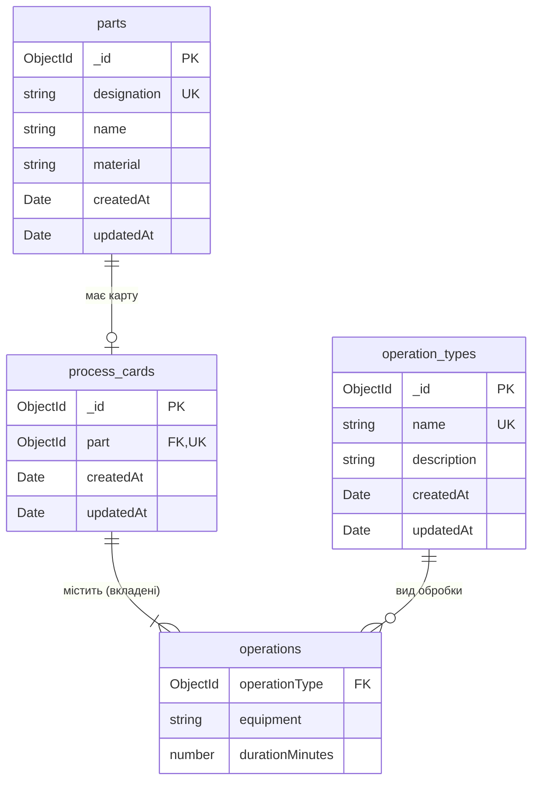

## `run.sh`

```bash
#!/usr/bin/env bash
if [ -z "${BASH_VERSION:-}" ]; then
  echo "Run this script with bash: ./run.sh <dev|prod>" >&2
  exit 1
fi

set -euo pipefail

ROOT="$(cd "$(dirname "${BASH_SOURCE[0]}")" && pwd)"
readonly ROOT
readonly APPS=(api web)
readonly API_PORT="${PORT:-3000}"
readonly WEB_PORT=4200
readonly MONGO_PORT="${MONGO_PORT:-27018}"
export MONGO_PORT
readonly MONGO_CONTAINER=kpi-labs-mongo
readonly MONGO_WAIT_SECONDS=120
readonly STOP_TIMEOUT_SECONDS=10

if [[ -t 1 ]]; then
  readonly COLOR=1
else
  readonly COLOR=0
fi

SERVICE_PIDS=()
DATABASE_STARTED=0

usage() {
  cat <<EOF
Usage: ./run.sh <dev|prod>

  dev   development mode at http://localhost:${WEB_PORT}, restarts and rebuilds on code changes
  prod  type check and production build, then the server serves the client at http://localhost:${API_PORT}

Both modes start the MongoDB container ${MONGO_CONTAINER} (Docker) on port ${MONGO_PORT} if it is not running yet.
EOF
}

paint() {
  if (( COLOR )); then
    printf '\033[%sm%s\033[0m' "$1" "$2"
  else
    printf '%s' "$2"
  fi
}

info() {
  printf '%s %s\n' "$(paint '1;36' '[run]')" "$*"
}

fail() {
  printf '%s %s\n' "$(paint '1;31' '[run]')" "$*" >&2
  exit 1
}

check_requirements() {
  if (( BASH_VERSINFO[0] < 4 || (BASH_VERSINFO[0] == 4 && BASH_VERSINFO[1] < 3) )); then
    fail "bash 4.3 or newer is required, found ${BASH_VERSION}"
  fi
  command -v setsid >/dev/null 2>&1 || fail "setsid not found (install the util-linux package)"
  command -v node >/dev/null 2>&1 || fail "Node.js not found, version 24+ is required"
  command -v npm >/dev/null 2>&1 || fail "npm not found"
  local node_major
  node_major="$(node -p 'process.versions.node.split(".")[0]')"
  (( node_major >= 24 )) || fail "Node.js 24+ is required, found $(node --version)"
  command -v docker >/dev/null 2>&1 || fail "Docker not found, it is required to run MongoDB"
  docker compose version >/dev/null 2>&1 || fail "Docker Compose plugin not found (docker compose)"
  docker info >/dev/null 2>&1 || fail "Docker daemon is not reachable: start Docker and check access to it"
}

port_open() {
  (exec 3<>"/dev/tcp/localhost/$1") 2>/dev/null
}

ensure_port_free() {
  if port_open "$1"; then
    fail "Port $1 is already in use: stop the process that is using it"
  fi
}

database_running() {
  [[ "$(docker inspect --format '{{.State.Running}}' "$MONGO_CONTAINER" 2>/dev/null)" == true ]]
}

start_database() {
  if database_running; then
    info "database: container ${MONGO_CONTAINER} is already running"
  else
    ensure_port_free "$MONGO_PORT"
    info "database: starting container ${MONGO_CONTAINER} on port ${MONGO_PORT}"
    DATABASE_STARTED=1
  fi
  docker compose --file "$ROOT/compose.yaml" --progress quiet \
    up --detach --no-build --wait --wait-timeout "$MONGO_WAIT_SECONDS" mongo ||
    fail "database: container ${MONGO_CONTAINER} did not become healthy, see: docker logs ${MONGO_CONTAINER}"
  info "database: MongoDB is ready"
}

stop_database() {
  (( DATABASE_STARTED )) || return 0
  info "database: stopping container ${MONGO_CONTAINER}"
  docker compose --file "$ROOT/compose.yaml" --progress quiet stop mongo >/dev/null 2>&1 || true
  DATABASE_STARTED=0
}

install_dependencies() {
  local app dir
  for app in "${APPS[@]}"; do
    dir="$ROOT/$app"
    if [[ ! -d "$dir/node_modules" || "$dir/package-lock.json" -nt "$dir/node_modules/.package-lock.json" ]]; then
      info "$app: installing dependencies"
      (cd "$dir" && npm ci --no-audit --no-fund)
    fi
  done
}

build_apps() {
  local app
  for app in "${APPS[@]}"; do
    info "$app: building"
    (cd "$ROOT/$app" && npm run build --no-progress)
  done
}

prefix_lines() {
  trap '' INT TERM
  local line
  while IFS= read -r line || [[ -n "$line" ]]; do
    printf '%s %s\n' "$1" "$line"
  done
}

start_service() {
  local app="$1" script="$2" color="$3" label
  label="$(paint "$color" "[$app]")"
  setsid bash -c 'set -o pipefail; cd "$1" && npm run "$2" 2>&1 | prefix_lines "$3"' \
    "$app" "$ROOT/$app" "$script" "$label" </dev/null &
  SERVICE_PIDS+=("$!")
}

all_services_running() {
  local pid
  for pid in "${SERVICE_PIDS[@]}"; do
    kill -0 "$pid" 2>/dev/null || return 1
  done
}

wait_until_ready() {
  local port ready
  while all_services_running; do
    ready=1
    for port in "$@"; do
      if ! port_open "$port"; then
        ready=0
        break
      fi
    done
    if (( ready )); then
      return 0
    fi
    sleep 0.5
  done
  return 1
}

any_service_alive() {
  local pid
  for pid in "${SERVICE_PIDS[@]}"; do
    if kill -0 -- "-$pid" 2>/dev/null; then
      return 0
    fi
  done
  return 1
}

stop_services() {
  (( ${#SERVICE_PIDS[@]} > 0 )) || return 0
  info "stopping services"
  local pid deadline=$(( SECONDS + STOP_TIMEOUT_SECONDS ))
  for pid in "${SERVICE_PIDS[@]}"; do
    kill -TERM -- "-$pid" 2>/dev/null || true
  done
  while any_service_alive && (( SECONDS < deadline )); do
    sleep 0.2
  done
  for pid in "${SERVICE_PIDS[@]}"; do
    kill -KILL -- "-$pid" 2>/dev/null || true
  done
  wait 2>/dev/null || true
  SERVICE_PIDS=()
  info "stopped"
}

cleanup() {
  trap '' INT TERM
  stop_services
  stop_database
}

main() {
  if [[ $# -ne 1 ]]; then
    usage >&2
    return 2
  fi
  local mode="$1"
  case "$mode" in
    dev | prod) ;;
    -h | --help)
      usage
      return 0
      ;;
    *)
      usage >&2
      return 2
      ;;
  esac

  check_requirements
  ensure_port_free "$API_PORT"
  if [[ "$mode" == dev ]]; then
    ensure_port_free "$WEB_PORT"
  fi

  export NG_CLI_ANALYTICS=false
  if (( COLOR )); then
    export FORCE_COLOR=1
  fi

  install_dependencies
  if [[ "$mode" == prod ]]; then
    build_apps
  fi

  trap cleanup EXIT
  trap 'exit 130' INT
  trap 'exit 143' TERM
  export -f prefix_lines

  start_database

  local app_port ports
  if [[ "$mode" == dev ]]; then
    info "starting in development mode"
    start_service api dev '35'
    start_service web dev '32'
    app_port="$WEB_PORT"
    ports=("$API_PORT" "$WEB_PORT")
  else
    info "starting in production mode"
    export STATIC_DIR="$ROOT/web/dist/web/browser"
    start_service api start '35'
    app_port="$API_PORT"
    ports=("$API_PORT")
  fi

  if wait_until_ready "${ports[@]}"; then
    info "$(paint '1;32' "Application is ready to use: http://localhost:${app_port}") (Ctrl+C to stop)"
  fi

  local status=0
  wait -n || status=$?
  info "a service exited with code $status, stopping the rest"
  return "$status"
}

main "$@"
```

## `compose.yaml`

```yaml
name: kpi-labs

services:
  mongo:
    image: mongo:8
    container_name: kpi-labs-mongo
    ports:
      - 127.0.0.1:${MONGO_PORT:-27018}:27017
    volumes:
      - mongo-data:/data/db
    healthcheck:
      test: ['CMD', 'mongosh', '--quiet', '--eval', 'quit(db.adminCommand({ ping: 1 }).ok ? 0 : 1)']
      interval: 5s
      timeout: 5s
      retries: 12
      start_period: 20s

volumes:
  mongo-data:
    name: kpi-labs-mongo-data
```

## `DB_DESIGN.md`

````markdown
# Схема бази даних

MongoDB 8, база `lab04`.

## ER-діаграма



## Колекції

### `parts` — деталі

| Поле          | Тип            | Обмеження                                                                  |
| ------------- | -------------- | -------------------------------------------------------------------------- |
| `_id`         | ObjectId       | первинний ключ                                                             |
| `designation` | string         | обов'язкове, 3–40 символів (літери, цифри, `.`, `-`, `/`), верхній регістр |
| `name`        | string         | обов'язкове, 2–120 символів                                                |
| `material`    | string \| null | до 80 символів, за замовчуванням `null`                                    |
| `createdAt`   | Date           | ставиться автоматично                                                      |
| `updatedAt`   | Date           | оновлюється автоматично                                                    |

### `operation_types` — види обробки

| Поле          | Тип            | Обмеження                                |
| ------------- | -------------- | ---------------------------------------- |
| `_id`         | ObjectId       | первинний ключ                           |
| `name`        | string         | обов'язкове, 2–60 символів               |
| `description` | string \| null | до 300 символів, за замовчуванням `null` |
| `createdAt`   | Date           | ставиться автоматично                    |
| `updatedAt`   | Date           | оновлюється автоматично                  |

### `process_cards` — технологічні карти

| Поле         | Тип         | Обмеження                                          |
| ------------ | ----------- | -------------------------------------------------- |
| `_id`        | ObjectId    | первинний ключ                                     |
| `part`       | ObjectId    | обов'язкове, посилання на `parts._id`              |
| `operations` | Operation[] | від 1 до 30 вкладених документів, порядок важливий |
| `createdAt`  | Date        | ставиться автоматично                              |
| `updatedAt`  | Date        | оновлюється автоматично                            |

### `operations` — вкладені документи в `process_cards.operations`

| Поле              | Тип            | Обмеження                                       |
| ----------------- | -------------- | ----------------------------------------------- |
| `operationType`   | ObjectId       | обов'язкове, посилання на `operation_types._id` |
| `equipment`       | string \| null | до 120 символів, за замовчуванням `null`        |
| `durationMinutes` | number         | обов'язкове, від 0,1 до 1440 хв з кроком 0,1 хв |

## Індекси

| Колекція          | Ключ                                | Параметри                                             | Призначення                                                |
| ----------------- | ----------------------------------- | ----------------------------------------------------- | ---------------------------------------------------------- |
| `parts`           | `{ _id: 1 }`                        | унікальний                                            | первинний ключ                                             |
| `parts`           | `{ designation: 1 }`                | унікальний                                            | позначення деталі не повторюється                          |
| `operation_types` | `{ _id: 1 }`                        | унікальний                                            | первинний ключ                                             |
| `operation_types` | `{ name: 1 }`                       | унікальний, collation `{ locale: 'uk', strength: 2 }` | назва не повторюється без урахування регістру              |
| `process_cards`   | `{ _id: 1 }`                        | унікальний                                            | первинний ключ                                             |
| `process_cards`   | `{ part: 1 }`                       | унікальний                                            | одна технологічна карта на деталь                          |
| `process_cards`   | `{ 'operations.operationType': 1 }` | multikey                                              | швидка перевірка, чи використовується вид обробки в картах |

## Зв'язки

| Зв'язок                          | Кардинальність | Як зберігається                      | Цілісність                                                      |
| -------------------------------- | -------------- | ------------------------------------ | --------------------------------------------------------------- |
| `parts` → `process_cards`        | 1 : 0..1       | посилання `process_cards.part`       | унікальний індекс; деталь із картою видалити не можна           |
| `process_cards` → `operations`   | 1 : 1..30      | масив вкладених документів у карті   | операції видаляються разом із картою                            |
| `operation_types` → `operations` | 1 : 0..N       | посилання `operations.operationType` | вид обробки, що використовується в операціях, видалити не можна |
````

## `contracts/api.contract.ts`

```typescript
export interface PartRequest {
  readonly designation: string;
  readonly name: string;
  readonly material?: string | null;
}

export interface PartDto {
  readonly id: string;
  readonly designation: string;
  readonly name: string;
  readonly material: string | null;
  readonly createdAt: string;
  readonly updatedAt: string;
}

export interface PartResponse {
  readonly part: PartDto;
}

export interface PartsResponse {
  readonly parts: readonly PartDto[];
}

export interface OperationTypeRequest {
  readonly name: string;
  readonly description?: string | null;
}

export interface OperationTypeDto {
  readonly id: string;
  readonly name: string;
  readonly description: string | null;
  readonly createdAt: string;
  readonly updatedAt: string;
}

export interface OperationTypeResponse {
  readonly operationType: OperationTypeDto;
}

export interface OperationTypesResponse {
  readonly operationTypes: readonly OperationTypeDto[];
}

export interface OperationRequest {
  readonly operationTypeId: string;
  readonly equipment?: string | null;
  readonly durationMinutes: number;
}

export interface ProcessCardRequest {
  readonly partId: string;
  readonly operations: readonly OperationRequest[];
}

export interface PartRefDto {
  readonly id: string;
  readonly designation: string;
  readonly name: string;
  readonly material: string | null;
}

export interface OperationTypeRefDto {
  readonly id: string;
  readonly name: string;
}

export interface OperationDto {
  readonly number: number;
  readonly operationType: OperationTypeRefDto;
  readonly equipment: string | null;
  readonly durationMinutes: number;
}

export interface ProcessCardDto {
  readonly id: string;
  readonly part: PartRefDto;
  readonly operations: readonly OperationDto[];
  readonly totalDurationMinutes: number;
  readonly createdAt: string;
  readonly updatedAt: string;
}

export interface ProcessCardResponse {
  readonly processCard: ProcessCardDto;
}

export interface ProcessCardsResponse {
  readonly processCards: readonly ProcessCardDto[];
}

export interface WorkloadDto {
  readonly operationType: OperationTypeRefDto;
  readonly operations: number;
  readonly totalDurationMinutes: number;
}

export interface StatisticsResponse {
  readonly parts: number;
  readonly operationTypes: number;
  readonly processCards: number;
  readonly operations: number;
  readonly totalDurationMinutes: number;
  readonly workload: readonly WorkloadDto[];
}

export interface HealthResponse {
  readonly status: 'ok' | 'degraded';
  readonly database: 'up' | 'down';
}

export type ErrorCode =
  | 'VALIDATION_ERROR'
  | 'NOT_FOUND'
  | 'PART_DESIGNATION_TAKEN'
  | 'OPERATION_TYPE_NAME_TAKEN'
  | 'PART_ALREADY_HAS_CARD'
  | 'PART_IN_USE'
  | 'OPERATION_TYPE_IN_USE'
  | 'UNKNOWN_PART'
  | 'UNKNOWN_OPERATION_TYPE'
  | 'DATABASE_UNAVAILABLE'
  | 'INTERNAL_ERROR';

export interface ValidationIssueDto {
  readonly path: string;
  readonly message: string;
}

export interface ErrorResponse {
  readonly error: {
    readonly code: ErrorCode;
    readonly message: string;
    readonly issues?: readonly ValidationIssueDto[];
  };
}
```

## `api/.env.example`

```dotenv
PORT=3000

MONGODB_URI=mongodb://127.0.0.1:27018/lab04
MONGODB_TIMEOUT_MS=5000

SEED_DEMO_DATA=true

LOG_LEVEL=debug
```

## `api/package.json`

```json
{
  "name": "lab-04-rest-crud-api",
  "version": "1.0.0",
  "private": true,
  "description": "REST API with CRUD over MongoDB for technological process cards",
  "type": "module",
  "engines": {
    "node": ">=24"
  },
  "scripts": {
    "dev": "NODE_ENV=development node --watch src/main.ts",
    "build": "tsc --noEmit",
    "start": "NODE_ENV=production node src/main.ts",
    "test": "node --test --test-reporter=spec \"../tmp/tests/api/**/*.test.ts\""
  },
  "dependencies": {
    "express": "^5.3.0",
    "mongoose": "^9.11.1",
    "pino": "^10.4.0",
    "zod": "^4.6.6"
  },
  "devDependencies": {
    "@types/express": "^5.0.6",
    "@types/node": "^24.19.2",
    "pino-pretty": "^13.2.0",
    "typescript": "^7.0.2"
  }
}
```

## `api/tsconfig.json`

```json
{
  "compilerOptions": {
    "target": "esnext",
    "lib": ["esnext"],
    "module": "nodenext",
    "moduleResolution": "nodenext",
    "types": ["node"],

    "strict": true,
    "noUncheckedIndexedAccess": true,
    "noImplicitOverride": true,
    "noFallthroughCasesInSwitch": true,

    "verbatimModuleSyntax": true,
    "erasableSyntaxOnly": true,
    "allowImportingTsExtensions": true,
    "noEmit": true,

    "skipLibCheck": true
  },
  "include": ["src"]
}
```

## `api/src/app.ts`

```typescript
import { createServer } from 'node:http';
import { OperationTypesService } from './application/operation-types.service.ts';
import { PartsService } from './application/parts.service.ts';
import type { Logger, Storage } from './application/ports.ts';
import { ProcessCardsService } from './application/process-cards.service.ts';
import { SeedDemoData } from './application/seed-demo-data.ts';
import { StatisticsService } from './application/statistics.service.ts';
import type { AppConfig } from './config.ts';
import { close, createHttpApp, listen } from './infrastructure/http/server.ts';
import { createPinoLogger } from './infrastructure/logging/pino.logger.ts';
import { MongoStorage } from './infrastructure/persistence/mongo/mongo-storage.ts';

export interface Infrastructure {
  readonly logger: Logger;
  readonly storage: Storage;
}

export interface App {
  start(): Promise<{ readonly port: number; readonly seeded: boolean }>;
  stop(): Promise<void>;
}

export async function createApp(
  config: AppConfig,
  overrides: Partial<Infrastructure> = {},
): Promise<App> {
  const logger =
    overrides.logger ??
    createPinoLogger({ level: config.logLevel, pretty: config.logFormat === 'pretty' });
  const storage =
    overrides.storage ??
    (await MongoStorage.connect({
      uri: config.mongodb.uri,
      timeoutMs: config.mongodb.timeoutMs,
      logger,
    }));
  const repositories = {
    parts: storage.parts,
    operationTypes: storage.operationTypes,
    processCards: storage.processCards,
  };

  const server = createServer(
    createHttpApp({
      logger,
      bodyLimitBytes: config.bodyLimitBytes,
      staticDir: config.staticDir,
      isDatabaseAvailable: () => storage.isAvailable(),
      parts: new PartsService(repositories),
      operationTypes: new OperationTypesService(repositories),
      processCards: new ProcessCardsService(repositories),
      statistics: new StatisticsService(repositories),
    }),
  );
  const seedDemoData = new SeedDemoData(repositories);

  return {
    async start() {
      const seeded = config.seedDemoData && (await seedDemoData.execute());
      return { port: await listen(server, config.port), seeded };
    },
    async stop() {
      if (server.listening) {
        await close(server);
      }
      await storage.close();
    },
  };
}
```

## `api/src/application/demo-data.ts`

```typescript
import type { OperationTypeInput } from '../domain/operation-type.ts';
import type { PartInput } from '../domain/part.ts';

export interface DemoOperation {
  readonly type: string;
  readonly equipment: string | null;
  readonly durationMinutes: number;
}

export interface DemoProcessCard {
  readonly part: string;
  readonly operations: readonly DemoOperation[];
}

export const DEMO_OPERATION_TYPES: readonly OperationTypeInput[] = [
  { name: 'Заготівельна', description: 'Відрізання заготовки з прутка, труби або листа' },
  { name: 'Токарна', description: 'Обробка поверхонь обертання різцями на токарному верстаті' },
  { name: 'Фрезерна', description: 'Обробка площин, уступів, пазів і зубів фрезами' },
  { name: 'Свердлильна', description: 'Свердління, зенкерування та розвертання отворів' },
  {
    name: 'Шліфувальна',
    description: 'Чистова обробка абразивним кругом до точного розміру й низької шорсткості',
  },
  { name: 'Термічна', description: 'Гартування та відпуск для отримання потрібної твердості' },
  { name: 'Слюсарна', description: 'Зняття задирок і притуплення гострих кромок' },
  { name: 'Контрольна', description: 'Перевірка розмірів, форми та шорсткості за кресленням' },
];

export const DEMO_PARTS: readonly PartInput[] = [
  { designation: 'КПІ.301.011', name: 'Вал ведучий', material: 'Сталь 45' },
  { designation: 'КПІ.302.017', name: 'Колесо зубчасте циліндричне', material: 'Сталь 40Х' },
  { designation: 'КПІ.305.004', name: 'Втулка', material: 'Бронза БрО10Ф1' },
  { designation: 'КПІ.310.022', name: 'Корпус підшипника', material: 'Чавун СЧ20' },
  { designation: 'КПІ.320.008', name: 'Фланець', material: 'Сталь 20' },
];

export const DEMO_PROCESS_CARDS: readonly DemoProcessCard[] = [
  {
    part: 'КПІ.301.011',
    operations: [
      { type: 'Заготівельна', equipment: 'Стрічкопильний верстат 8544', durationMinutes: 2.5 },
      { type: 'Токарна', equipment: 'Токарно-гвинторізний верстат 16К20', durationMinutes: 18 },
      { type: 'Фрезерна', equipment: 'Вертикально-фрезерний верстат 6Р12', durationMinutes: 9.5 },
      { type: 'Термічна', equipment: 'Установка СВЧ-гартування', durationMinutes: 45 },
      { type: 'Шліфувальна', equipment: 'Круглошліфувальний верстат 3М151', durationMinutes: 12 },
      { type: 'Контрольна', equipment: null, durationMinutes: 4 },
    ],
  },
  {
    part: 'КПІ.302.017',
    operations: [
      { type: 'Заготівельна', equipment: 'Стрічкопильний верстат 8544', durationMinutes: 3 },
      { type: 'Токарна', equipment: 'Токарний верстат з ЧПК 16А20Ф3', durationMinutes: 22 },
      { type: 'Фрезерна', equipment: 'Зубофрезерний верстат 5К324', durationMinutes: 35 },
      { type: 'Термічна', equipment: 'Шахтна піч', durationMinutes: 60 },
      {
        type: 'Шліфувальна',
        equipment: 'Внутрішньошліфувальний верстат 3К228',
        durationMinutes: 15,
      },
      { type: 'Контрольна', equipment: null, durationMinutes: 5 },
    ],
  },
  {
    part: 'КПІ.305.004',
    operations: [
      { type: 'Токарна', equipment: 'Токарно-револьверний верстат 1П365', durationMinutes: 11.5 },
      {
        type: 'Свердлильна',
        equipment: 'Вертикально-свердлильний верстат 2Н135',
        durationMinutes: 4,
      },
      { type: 'Слюсарна', equipment: 'Верстак слюсарний', durationMinutes: 3 },
      { type: 'Контрольна', equipment: null, durationMinutes: 2 },
    ],
  },
  {
    part: 'КПІ.310.022',
    operations: [
      { type: 'Фрезерна', equipment: 'Горизонтально-фрезерний верстат 6Р82', durationMinutes: 28 },
      {
        type: 'Свердлильна',
        equipment: 'Радіально-свердлильний верстат 2Н55',
        durationMinutes: 14,
      },
      { type: 'Слюсарна', equipment: 'Верстак слюсарний', durationMinutes: 6 },
      { type: 'Контрольна', equipment: null, durationMinutes: 5 },
    ],
  },
];
```

## `api/src/application/operation-types.service.ts`

```typescript
import {
  createOperationTypeDetails,
  type OperationType,
  type OperationTypeId,
  type OperationTypeInput,
} from '../domain/operation-type.ts';
import type { OperationTypeRepository, ProcessCardRepository, WriteResult } from './ports.ts';
import { err, ok, type Result } from './result.ts';

const NOT_FOUND = err('NOT_FOUND', 'Operation type not found');
const NAME_TAKEN = err(
  'OPERATION_TYPE_NAME_TAKEN',
  'An operation type with this name already exists',
);
const IN_USE = err(
  'OPERATION_TYPE_IN_USE',
  'The operation type is used in process cards, remove those operations first',
);

export class OperationTypesService {
  readonly #operationTypes: OperationTypeRepository;
  readonly #processCards: ProcessCardRepository;

  constructor(deps: {
    operationTypes: OperationTypeRepository;
    processCards: ProcessCardRepository;
  }) {
    this.#operationTypes = deps.operationTypes;
    this.#processCards = deps.processCards;
  }

  list(): Promise<readonly OperationType[]> {
    return this.#operationTypes.list();
  }

  async get(id: OperationTypeId): Promise<Result<OperationType>> {
    const operationType = await this.#operationTypes.findById(id);
    return operationType ? ok(operationType) : NOT_FOUND;
  }

  async create(input: OperationTypeInput): Promise<Result<OperationType>> {
    return fromWrite(await this.#operationTypes.create(createOperationTypeDetails(input)));
  }

  async update(id: OperationTypeId, input: OperationTypeInput): Promise<Result<OperationType>> {
    return fromWrite(await this.#operationTypes.update(id, createOperationTypeDetails(input)));
  }

  async remove(id: OperationTypeId): Promise<Result<void>> {
    if (await this.#processCards.isOperationTypeUsed(id)) {
      return IN_USE;
    }
    return (await this.#operationTypes.remove(id)) ? ok(undefined) : NOT_FOUND;
  }
}

function fromWrite(saved: WriteResult<OperationType>): Result<OperationType> {
  if (saved.ok) {
    return ok(saved.value);
  }
  return saved.reason === 'duplicate' ? NAME_TAKEN : NOT_FOUND;
}
```

## `api/src/application/parts.service.ts`

```typescript
import { createPartDetails, type Part, type PartId, type PartInput } from '../domain/part.ts';
import type { PartRepository, ProcessCardRepository, WriteResult } from './ports.ts';
import { err, ok, type Result } from './result.ts';

const NOT_FOUND = err('NOT_FOUND', 'Part not found');
const DESIGNATION_TAKEN = err(
  'PART_DESIGNATION_TAKEN',
  'A part with this designation already exists',
);
const IN_USE = err('PART_IN_USE', 'The part has a process card, delete the card first');

export class PartsService {
  readonly #parts: PartRepository;
  readonly #processCards: ProcessCardRepository;

  constructor(deps: { parts: PartRepository; processCards: ProcessCardRepository }) {
    this.#parts = deps.parts;
    this.#processCards = deps.processCards;
  }

  list(): Promise<readonly Part[]> {
    return this.#parts.list();
  }

  async get(id: PartId): Promise<Result<Part>> {
    const part = await this.#parts.findById(id);
    return part ? ok(part) : NOT_FOUND;
  }

  async create(input: PartInput): Promise<Result<Part>> {
    return fromWrite(await this.#parts.create(createPartDetails(input)));
  }

  async update(id: PartId, input: PartInput): Promise<Result<Part>> {
    return fromWrite(await this.#parts.update(id, createPartDetails(input)));
  }

  async remove(id: PartId): Promise<Result<void>> {
    if (await this.#processCards.isPartUsed(id)) {
      return IN_USE;
    }
    return (await this.#parts.remove(id)) ? ok(undefined) : NOT_FOUND;
  }
}

function fromWrite(saved: WriteResult<Part>): Result<Part> {
  if (saved.ok) {
    return ok(saved.value);
  }
  return saved.reason === 'duplicate' ? DESIGNATION_TAKEN : NOT_FOUND;
}
```

## `api/src/application/ports.ts`

```typescript
import type {
  OperationType,
  OperationTypeDetails,
  OperationTypeId,
} from '../domain/operation-type.ts';
import type { Part, PartDetails, PartId } from '../domain/part.ts';
import type { ProcessCard, ProcessCardDetails, ProcessCardId } from '../domain/process-card.ts';

export type WriteResult<T> =
  | { readonly ok: true; readonly value: T }
  | { readonly ok: false; readonly reason: 'duplicate' | 'not-found' };

export interface PartRepository {
  list(): Promise<readonly Part[]>;
  count(): Promise<number>;
  findById(id: PartId): Promise<Part | undefined>;
  findByIds(ids: readonly PartId[]): Promise<readonly Part[]>;
  create(details: PartDetails): Promise<WriteResult<Part>>;
  update(id: PartId, details: PartDetails): Promise<WriteResult<Part>>;
  remove(id: PartId): Promise<boolean>;
}

export interface OperationTypeRepository {
  list(): Promise<readonly OperationType[]>;
  count(): Promise<number>;
  findById(id: OperationTypeId): Promise<OperationType | undefined>;
  findByIds(ids: readonly OperationTypeId[]): Promise<readonly OperationType[]>;
  create(details: OperationTypeDetails): Promise<WriteResult<OperationType>>;
  update(id: OperationTypeId, details: OperationTypeDetails): Promise<WriteResult<OperationType>>;
  remove(id: OperationTypeId): Promise<boolean>;
}

export interface OperationTypeWorkload {
  readonly operationTypeId: OperationTypeId;
  readonly operations: number;
  readonly totalDurationMinutes: number;
}

export interface ProcessCardRepository {
  list(): Promise<readonly ProcessCard[]>;
  count(): Promise<number>;
  findById(id: ProcessCardId): Promise<ProcessCard | undefined>;
  create(details: ProcessCardDetails): Promise<WriteResult<ProcessCard>>;
  update(id: ProcessCardId, details: ProcessCardDetails): Promise<WriteResult<ProcessCard>>;
  remove(id: ProcessCardId): Promise<boolean>;
  isPartUsed(id: PartId): Promise<boolean>;
  isOperationTypeUsed(id: OperationTypeId): Promise<boolean>;
  workload(): Promise<readonly OperationTypeWorkload[]>;
}

export interface Storage {
  readonly parts: PartRepository;
  readonly operationTypes: OperationTypeRepository;
  readonly processCards: ProcessCardRepository;
  isAvailable(): Promise<boolean>;
  close(): Promise<void>;
}

export class StorageUnavailableError extends Error {
  override readonly name = 'StorageUnavailableError';
}

export type LogLevel = 'debug' | 'info' | 'warn' | 'error';

export type LogContext = Readonly<Record<string, unknown>>;

export interface Logger {
  debug(message: string, context?: LogContext): void;
  info(message: string, context?: LogContext): void;
  warn(message: string, context?: LogContext): void;
  error(message: string, context?: LogContext): void;
  child(bindings: LogContext): Logger;
}
```

## `api/src/application/process-cards.service.ts`

```typescript
import type { OperationType, OperationTypeId } from '../domain/operation-type.ts';
import type { Part } from '../domain/part.ts';
import {
  createProcessCardDetails,
  referencedOperationTypes,
  type ProcessCard,
  type ProcessCardDetails,
  type ProcessCardId,
  type ProcessCardInput,
} from '../domain/process-card.ts';
import type {
  OperationTypeRepository,
  PartRepository,
  ProcessCardRepository,
  WriteResult,
} from './ports.ts';
import { err, ok, type Result } from './result.ts';

const NOT_FOUND = err('NOT_FOUND', 'Process card not found');
const PART_HAS_CARD = err('PART_ALREADY_HAS_CARD', 'The part already has a process card');
const UNKNOWN_PART = err('UNKNOWN_PART', 'The referenced part does not exist');

export interface ProcessCardView {
  readonly card: ProcessCard;
  readonly part: Part;
  readonly operationTypes: ReadonlyMap<OperationTypeId, OperationType>;
}

export class ProcessCardsService {
  readonly #processCards: ProcessCardRepository;
  readonly #parts: PartRepository;
  readonly #operationTypes: OperationTypeRepository;

  constructor(deps: {
    processCards: ProcessCardRepository;
    parts: PartRepository;
    operationTypes: OperationTypeRepository;
  }) {
    this.#processCards = deps.processCards;
    this.#parts = deps.parts;
    this.#operationTypes = deps.operationTypes;
  }

  async list(): Promise<readonly ProcessCardView[]> {
    const views = await this.#views(await this.#processCards.list());
    return views.toSorted((a, b) => a.part.designation.localeCompare(b.part.designation, 'uk'));
  }

  async get(id: ProcessCardId): Promise<Result<ProcessCardView>> {
    const card = await this.#processCards.findById(id);
    return card ? ok(await this.#view(card)) : NOT_FOUND;
  }

  async create(input: ProcessCardInput): Promise<Result<ProcessCardView>> {
    const details = createProcessCardDetails(input);
    const invalid = await this.#checkReferences(details);
    if (invalid) {
      return invalid;
    }
    return this.#fromWrite(await this.#processCards.create(details));
  }

  async update(id: ProcessCardId, input: ProcessCardInput): Promise<Result<ProcessCardView>> {
    const details = createProcessCardDetails(input);
    if (!(await this.#processCards.findById(id))) {
      return NOT_FOUND;
    }
    const invalid = await this.#checkReferences(details);
    if (invalid) {
      return invalid;
    }
    return this.#fromWrite(await this.#processCards.update(id, details));
  }

  async remove(id: ProcessCardId): Promise<Result<void>> {
    return (await this.#processCards.remove(id)) ? ok(undefined) : NOT_FOUND;
  }

  async #checkReferences(details: ProcessCardDetails): Promise<Result<never> | null> {
    if (!(await this.#parts.findById(details.partId))) {
      return UNKNOWN_PART;
    }
    const ids = referencedOperationTypes(details);
    const found = new Set((await this.#operationTypes.findByIds(ids)).map((type) => type.id));
    const missing = ids.find((id) => !found.has(id));
    return missing === undefined
      ? null
      : err('UNKNOWN_OPERATION_TYPE', `Operation type ${missing} does not exist`);
  }

  async #fromWrite(saved: WriteResult<ProcessCard>): Promise<Result<ProcessCardView>> {
    if (saved.ok) {
      return ok(await this.#view(saved.value));
    }
    return saved.reason === 'duplicate' ? PART_HAS_CARD : NOT_FOUND;
  }

  async #view(card: ProcessCard): Promise<ProcessCardView> {
    const [view] = await this.#views([card]);
    if (!view) {
      throw new Error(`Process card ${card.id} could not be resolved`);
    }
    return view;
  }

  async #views(cards: readonly ProcessCard[]): Promise<ProcessCardView[]> {
    const partIds = [...new Set(cards.map((card) => card.partId))];
    const typeIds = [...new Set(cards.flatMap(referencedOperationTypes))];
    const [parts, types] = await Promise.all([
      this.#parts.findByIds(partIds),
      this.#operationTypes.findByIds(typeIds),
    ]);
    const partsById = new Map(parts.map((part) => [part.id, part]));
    const operationTypes = new Map(types.map((type) => [type.id, type]));

    return cards.map((card) => {
      const part = partsById.get(card.partId);
      const missingType = card.operations.find(
        (operation) => !operationTypes.has(operation.operationTypeId),
      );
      if (!part || missingType) {
        throw new Error(`Process card ${card.id} references a deleted part or operation type`);
      }
      return { card, part, operationTypes };
    });
  }
}
```

## `api/src/application/result.ts`

```typescript
export type AppErrorCode =
  | 'NOT_FOUND'
  | 'PART_DESIGNATION_TAKEN'
  | 'OPERATION_TYPE_NAME_TAKEN'
  | 'PART_ALREADY_HAS_CARD'
  | 'PART_IN_USE'
  | 'OPERATION_TYPE_IN_USE'
  | 'UNKNOWN_PART'
  | 'UNKNOWN_OPERATION_TYPE';

export interface AppError {
  readonly code: AppErrorCode;
  readonly message: string;
}

export type Result<T> =
  { readonly ok: true; readonly value: T } | { readonly ok: false; readonly error: AppError };

export function ok<T>(value: T): Result<T> {
  return { ok: true, value };
}

export function err(code: AppErrorCode, message: string): Result<never> {
  return { ok: false, error: { code, message } };
}
```

## `api/src/application/seed-demo-data.ts`

```typescript
import { createOperationTypeDetails, type OperationTypeId } from '../domain/operation-type.ts';
import { createPartDetails, type PartId } from '../domain/part.ts';
import { createProcessCardDetails } from '../domain/process-card.ts';
import { DEMO_OPERATION_TYPES, DEMO_PARTS, DEMO_PROCESS_CARDS } from './demo-data.ts';
import type {
  OperationTypeRepository,
  PartRepository,
  ProcessCardRepository,
  WriteResult,
} from './ports.ts';

export class SeedDemoData {
  readonly #parts: PartRepository;
  readonly #operationTypes: OperationTypeRepository;
  readonly #processCards: ProcessCardRepository;

  constructor(deps: {
    parts: PartRepository;
    operationTypes: OperationTypeRepository;
    processCards: ProcessCardRepository;
  }) {
    this.#parts = deps.parts;
    this.#operationTypes = deps.operationTypes;
    this.#processCards = deps.processCards;
  }

  async execute(): Promise<boolean> {
    const counts = await Promise.all([
      this.#parts.count(),
      this.#operationTypes.count(),
      this.#processCards.count(),
    ]);
    if (counts.some((count) => count > 0)) {
      return false;
    }

    const typeIds = new Map<string, OperationTypeId>();
    for (const input of DEMO_OPERATION_TYPES) {
      const type = saved(await this.#operationTypes.create(createOperationTypeDetails(input)));
      typeIds.set(type.name, type.id);
    }

    const partIds = new Map<string, PartId>();
    for (const input of DEMO_PARTS) {
      const part = saved(await this.#parts.create(createPartDetails(input)));
      partIds.set(part.designation, part.id);
    }

    for (const card of DEMO_PROCESS_CARDS) {
      const details = createProcessCardDetails({
        partId: lookup(partIds, card.part),
        operations: card.operations.map((operation) => ({
          operationTypeId: lookup(typeIds, operation.type),
          equipment: operation.equipment,
          durationMinutes: operation.durationMinutes,
        })),
      });
      saved(await this.#processCards.create(details));
    }
    return true;
  }
}

function saved<T>(result: WriteResult<T>): T {
  if (!result.ok) {
    throw new Error(`Demo data could not be saved: ${result.reason}`);
  }
  return result.value;
}

function lookup<T>(ids: ReadonlyMap<string, T>, key: string): T {
  const id = ids.get(key);
  if (id === undefined) {
    throw new Error(`Demo data references an unknown record: ${key}`);
  }
  return id;
}
```

## `api/src/application/statistics.service.ts`

```typescript
import type { OperationType } from '../domain/operation-type.ts';
import { sumDurations } from '../domain/process-card.ts';
import type { OperationTypeRepository, PartRepository, ProcessCardRepository } from './ports.ts';

export interface WorkloadEntry {
  readonly operationType: OperationType;
  readonly operations: number;
  readonly totalDurationMinutes: number;
}

export interface Statistics {
  readonly parts: number;
  readonly operationTypes: number;
  readonly processCards: number;
  readonly operations: number;
  readonly totalDurationMinutes: number;
  readonly workload: readonly WorkloadEntry[];
}

export class StatisticsService {
  readonly #parts: PartRepository;
  readonly #operationTypes: OperationTypeRepository;
  readonly #processCards: ProcessCardRepository;

  constructor(deps: {
    parts: PartRepository;
    operationTypes: OperationTypeRepository;
    processCards: ProcessCardRepository;
  }) {
    this.#parts = deps.parts;
    this.#operationTypes = deps.operationTypes;
    this.#processCards = deps.processCards;
  }

  async collect(): Promise<Statistics> {
    const [parts, processCards, operationTypes, workload] = await Promise.all([
      this.#parts.count(),
      this.#processCards.count(),
      this.#operationTypes.list(),
      this.#processCards.workload(),
    ]);
    const byType = new Map(workload.map((entry) => [entry.operationTypeId, entry]));
    const entries = operationTypes
      .map((operationType) => ({
        operationType,
        operations: byType.get(operationType.id)?.operations ?? 0,
        totalDurationMinutes: byType.get(operationType.id)?.totalDurationMinutes ?? 0,
      }))
      .toSorted(
        (a, b) =>
          b.totalDurationMinutes - a.totalDurationMinutes ||
          a.operationType.name.localeCompare(b.operationType.name, 'uk'),
      );

    return {
      parts,
      operationTypes: operationTypes.length,
      processCards,
      operations: entries.reduce((total, entry) => total + entry.operations, 0),
      totalDurationMinutes: sumDurations(entries.map((entry) => entry.totalDurationMinutes)),
      workload: entries,
    };
  }
}
```

## `api/src/config.ts`

```typescript
import { z } from 'zod';
import type { LogLevel } from './application/ports.ts';

export type Environment = 'development' | 'production' | 'test';

export type LogFormat = 'pretty' | 'json';

const envSchema = z.object({
  NODE_ENV: z.enum(['development', 'production', 'test']).default('development'),
  PORT: z.coerce.number().int().min(0).max(65_535).default(3000),
  MONGODB_URI: z
    .string()
    .trim()
    .regex(/^mongodb(\+srv)?:\/\/\S+$/, 'Expected a mongodb:// or mongodb+srv:// connection string')
    .default('mongodb://127.0.0.1:27018/lab04'),
  MONGODB_TIMEOUT_MS: z.coerce.number().int().min(500).max(60_000).default(5000),
  SEED_DEMO_DATA: z.stringbool().optional(),
  LOG_LEVEL: z.enum(['debug', 'info', 'warn', 'error']).optional(),
  STATIC_DIR: z.string().trim().min(1).optional(),
});

export interface AppConfig {
  readonly environment: Environment;
  readonly port: number;
  readonly bodyLimitBytes: number;
  readonly mongodb: { readonly uri: string; readonly timeoutMs: number };
  readonly seedDemoData: boolean;
  readonly logLevel: LogLevel;
  readonly logFormat: LogFormat;
  readonly staticDir: string | undefined;
}

export class ConfigError extends Error {
  override readonly name = 'ConfigError';
}

export function loadConfig(env: Readonly<Record<string, string | undefined>>): AppConfig {
  const parsed = envSchema.safeParse(env);
  if (!parsed.success) {
    throw new ConfigError(`Invalid environment configuration:\n${z.prettifyError(parsed.error)}`);
  }
  const vars = parsed.data;
  return {
    environment: vars.NODE_ENV,
    port: vars.PORT,
    bodyLimitBytes: 64 * 1024,
    mongodb: { uri: vars.MONGODB_URI, timeoutMs: vars.MONGODB_TIMEOUT_MS },
    seedDemoData: vars.SEED_DEMO_DATA ?? vars.NODE_ENV === 'development',
    logLevel: vars.LOG_LEVEL ?? (vars.NODE_ENV === 'production' ? 'info' : 'debug'),
    logFormat: vars.NODE_ENV === 'development' ? 'pretty' : 'json',
    staticDir: vars.STATIC_DIR,
  };
}

export function redactConnectionString(uri: string): string {
  return uri.replace(/^(mongodb(?:\+srv)?:\/\/)[^@/]*@/, '$1***@');
}
```

## `api/src/domain/domain-error.ts`

```typescript
export class DomainError extends Error {
  override readonly name = 'DomainError';
}
```

## `api/src/domain/operation-type.ts`

```typescript
import { assertLength, normalizeText, optionalText } from './text.ts';

export type OperationTypeId = string & { readonly __brand: 'OperationTypeId' };

export const OPERATION_TYPE_NAME_LENGTH = { min: 2, max: 60 } as const;
export const OPERATION_TYPE_DESCRIPTION_LENGTH = { min: 1, max: 300 } as const;

export interface OperationTypeDetails {
  readonly name: string;
  readonly description: string | null;
}

export interface OperationType extends OperationTypeDetails {
  readonly id: OperationTypeId;
  readonly createdAt: Date;
  readonly updatedAt: Date;
}

export interface OperationTypeInput {
  readonly name: string;
  readonly description?: string | null | undefined;
}

export function normalizeOperationTypeName(raw: string): string {
  const name = normalizeText(raw);
  return name.charAt(0).toLocaleUpperCase('uk') + name.slice(1);
}

export function createOperationTypeDetails(input: OperationTypeInput): OperationTypeDetails {
  const name = normalizeOperationTypeName(input.name);
  assertLength('Operation type name', name, OPERATION_TYPE_NAME_LENGTH);
  const description = optionalText(input.description);
  if (description !== null) {
    assertLength('Operation type description', description, OPERATION_TYPE_DESCRIPTION_LENGTH);
  }
  return Object.freeze({ name, description });
}
```

## `api/src/domain/part.ts`

```typescript
import { DomainError } from './domain-error.ts';
import { assertLength, normalizeText, optionalText } from './text.ts';

export type PartId = string & { readonly __brand: 'PartId' };

export const PART_DESIGNATION_PATTERN = /^[\p{Lu}\p{N}][\p{Lu}\p{N}./-]{1,38}[\p{Lu}\p{N}]$/u;
export const PART_NAME_LENGTH = { min: 2, max: 120 } as const;
export const PART_MATERIAL_LENGTH = { min: 1, max: 80 } as const;

export interface PartDetails {
  readonly designation: string;
  readonly name: string;
  readonly material: string | null;
}

export interface Part extends PartDetails {
  readonly id: PartId;
  readonly createdAt: Date;
  readonly updatedAt: Date;
}

export interface PartInput {
  readonly designation: string;
  readonly name: string;
  readonly material?: string | null | undefined;
}

export function normalizeDesignation(raw: string): string {
  return raw.trim().toLocaleUpperCase('uk');
}

export function createPartDetails(input: PartInput): PartDetails {
  const designation = normalizeDesignation(input.designation);
  if (!PART_DESIGNATION_PATTERN.test(designation)) {
    throw new DomainError(`Invalid part designation: ${JSON.stringify(input.designation)}`);
  }
  const name = normalizeText(input.name);
  assertLength('Part name', name, PART_NAME_LENGTH);
  const material = optionalText(input.material);
  if (material !== null) {
    assertLength('Part material', material, PART_MATERIAL_LENGTH);
  }
  return Object.freeze({ designation, name, material });
}
```

## `api/src/domain/process-card.ts`

```typescript
import { DomainError } from './domain-error.ts';
import type { OperationTypeId } from './operation-type.ts';
import type { PartId } from './part.ts';
import { assertLength, optionalText } from './text.ts';

export type ProcessCardId = string & { readonly __brand: 'ProcessCardId' };

export const OPERATIONS_COUNT = { min: 1, max: 30 } as const;
export const DURATION_MINUTES = { min: 0.1, max: 1440 } as const;
export const EQUIPMENT_LENGTH = { min: 1, max: 120 } as const;
export const OPERATION_NUMBER_STEP = 5;

const TENTHS_PER_MINUTE = 10;

export interface Operation {
  readonly operationTypeId: OperationTypeId;
  readonly equipment: string | null;
  readonly durationMinutes: number;
}

export interface ProcessCardDetails {
  readonly partId: PartId;
  readonly operations: readonly Operation[];
}

export interface ProcessCard extends ProcessCardDetails {
  readonly id: ProcessCardId;
  readonly createdAt: Date;
  readonly updatedAt: Date;
}

export interface OperationInput {
  readonly operationTypeId: string;
  readonly equipment?: string | null | undefined;
  readonly durationMinutes: number;
}

export interface ProcessCardInput {
  readonly partId: string;
  readonly operations: readonly OperationInput[];
}

export function isValidDuration(minutes: number): boolean {
  const tenths = minutes * TENTHS_PER_MINUTE;
  return (
    Number.isFinite(minutes) &&
    minutes >= DURATION_MINUTES.min &&
    minutes <= DURATION_MINUTES.max &&
    Math.abs(tenths - Math.round(tenths)) < 1e-9
  );
}

export function roundDuration(minutes: number): number {
  return Math.round(minutes * TENTHS_PER_MINUTE) / TENTHS_PER_MINUTE;
}

export function sumDurations(durations: readonly number[]): number {
  const tenths = durations.reduce(
    (total, minutes) => total + Math.round(minutes * TENTHS_PER_MINUTE),
    0,
  );
  return tenths / TENTHS_PER_MINUTE;
}

export function totalDuration(card: ProcessCardDetails): number {
  return sumDurations(card.operations.map((operation) => operation.durationMinutes));
}

export function operationNumber(index: number): number {
  return (index + 1) * OPERATION_NUMBER_STEP;
}

export function referencedOperationTypes(card: ProcessCardDetails): readonly OperationTypeId[] {
  return [...new Set(card.operations.map((operation) => operation.operationTypeId))];
}

export function createProcessCardDetails(input: ProcessCardInput): ProcessCardDetails {
  const count = input.operations.length;
  if (count < OPERATIONS_COUNT.min || count > OPERATIONS_COUNT.max) {
    throw new DomainError(
      `A process card must have ${OPERATIONS_COUNT.min}-${OPERATIONS_COUNT.max} operations`,
    );
  }
  const operations = input.operations.map((operation, index) => {
    if (!isValidDuration(operation.durationMinutes)) {
      throw new DomainError(
        `Operation ${operationNumber(index)}: invalid duration ${operation.durationMinutes}`,
      );
    }
    const equipment = optionalText(operation.equipment);
    if (equipment !== null) {
      assertLength(`Operation ${operationNumber(index)} equipment`, equipment, EQUIPMENT_LENGTH);
    }
    return Object.freeze({
      operationTypeId: operation.operationTypeId as OperationTypeId,
      equipment,
      durationMinutes: operation.durationMinutes,
    });
  });
  return Object.freeze({ partId: input.partId as PartId, operations: Object.freeze(operations) });
}
```

## `api/src/domain/text.ts`

```typescript
import { DomainError } from './domain-error.ts';

export function normalizeText(raw: string): string {
  return raw.trim().replace(/\s+/gu, ' ');
}

export function optionalText(raw: string | null | undefined): string | null {
  const text = normalizeText(raw ?? '');
  return text.length > 0 ? text : null;
}

export function assertLength(
  field: string,
  value: string,
  limits: { readonly min: number; readonly max: number },
): void {
  if (value.length < limits.min || value.length > limits.max) {
    throw new DomainError(`${field} must be ${limits.min}-${limits.max} characters long`);
  }
}
```

## `api/src/infrastructure/http/contract.ts`

```typescript
export type * from '../../../../contracts/api.contract.ts';
```

## `api/src/infrastructure/http/errors.ts`

```typescript
import type { Response } from 'express';
import type { AppError, AppErrorCode, Result } from '../../application/result.ts';
import type { ErrorCode, ErrorResponse, ValidationIssueDto } from './contract.ts';

const STATUS_BY_APP_ERROR: Readonly<Record<AppErrorCode, number>> = {
  NOT_FOUND: 404,
  PART_DESIGNATION_TAKEN: 409,
  OPERATION_TYPE_NAME_TAKEN: 409,
  PART_ALREADY_HAS_CARD: 409,
  PART_IN_USE: 409,
  OPERATION_TYPE_IN_USE: 409,
  UNKNOWN_PART: 422,
  UNKNOWN_OPERATION_TYPE: 422,
};

export class RequestValidationError extends Error {
  override readonly name = 'RequestValidationError';
  readonly issues: readonly ValidationIssueDto[];

  constructor(issues: readonly ValidationIssueDto[]) {
    super(issues.map((issue) => `${issue.path}: ${issue.message}`).join('; '));
    this.issues = issues;
  }
}

export function sendError(
  response: Response,
  statusCode: number,
  code: ErrorCode,
  message: string,
  issues?: readonly ValidationIssueDto[],
): void {
  const body: ErrorResponse = { error: issues ? { code, message, issues } : { code, message } };
  response.status(statusCode).json(body);
}

export function sendAppError(response: Response, error: AppError): void {
  sendError(response, STATUS_BY_APP_ERROR[error.code], error.code, error.message);
}

export function sendResult<T>(
  response: Response,
  result: Result<T>,
  toBody: (value: T) => unknown,
  statusCode = 200,
): void {
  if (!result.ok) {
    sendAppError(response, result.error);
    return;
  }
  response.status(statusCode).json(toBody(result.value));
}

export function sendNoContent(response: Response, result: Result<void>): void {
  if (!result.ok) {
    sendAppError(response, result.error);
    return;
  }
  response.status(204).end();
}
```

## `api/src/infrastructure/http/mappers.ts`

```typescript
import type { ProcessCardView } from '../../application/process-cards.service.ts';
import type { Statistics } from '../../application/statistics.service.ts';
import type { OperationType } from '../../domain/operation-type.ts';
import type { Part } from '../../domain/part.ts';
import { operationNumber, totalDuration } from '../../domain/process-card.ts';
import type {
  OperationTypeDto,
  OperationTypeRefDto,
  PartDto,
  ProcessCardDto,
  StatisticsResponse,
} from './contract.ts';

export function toPartDto(part: Part): PartDto {
  return {
    id: part.id,
    designation: part.designation,
    name: part.name,
    material: part.material,
    createdAt: part.createdAt.toISOString(),
    updatedAt: part.updatedAt.toISOString(),
  };
}

export function toOperationTypeDto(operationType: OperationType): OperationTypeDto {
  return {
    id: operationType.id,
    name: operationType.name,
    description: operationType.description,
    createdAt: operationType.createdAt.toISOString(),
    updatedAt: operationType.updatedAt.toISOString(),
  };
}

export function toProcessCardDto({ card, part, operationTypes }: ProcessCardView): ProcessCardDto {
  return {
    id: card.id,
    part: {
      id: part.id,
      designation: part.designation,
      name: part.name,
      material: part.material,
    },
    operations: card.operations.map((operation, index) => {
      const operationType = operationTypes.get(operation.operationTypeId);
      if (!operationType) {
        throw new Error(`Operation type ${operation.operationTypeId} is not resolved`);
      }
      return {
        number: operationNumber(index),
        operationType: toOperationTypeRef(operationType),
        equipment: operation.equipment,
        durationMinutes: operation.durationMinutes,
      };
    }),
    totalDurationMinutes: totalDuration(card),
    createdAt: card.createdAt.toISOString(),
    updatedAt: card.updatedAt.toISOString(),
  };
}

export function toStatisticsResponse(statistics: Statistics): StatisticsResponse {
  return {
    parts: statistics.parts,
    operationTypes: statistics.operationTypes,
    processCards: statistics.processCards,
    operations: statistics.operations,
    totalDurationMinutes: statistics.totalDurationMinutes,
    workload: statistics.workload.map((entry) => ({
      operationType: toOperationTypeRef(entry.operationType),
      operations: entry.operations,
      totalDurationMinutes: entry.totalDurationMinutes,
    })),
  };
}

function toOperationTypeRef(operationType: OperationType): OperationTypeRefDto {
  return { id: operationType.id, name: operationType.name };
}
```

## `api/src/infrastructure/http/routes/crud.routes.ts`

```typescript
import { Router } from 'express';
import type { z } from 'zod';
import type { Result } from '../../../application/result.ts';
import { sendNoContent, sendResult } from '../errors.ts';
import { idParamsSchema, parseInput } from '../schemas.ts';

export interface CrudService<TEntity, TInput, TId extends string> {
  list(): Promise<readonly TEntity[]>;
  get(id: TId): Promise<Result<TEntity>>;
  create(input: TInput): Promise<Result<TEntity>>;
  update(id: TId, input: TInput): Promise<Result<TEntity>>;
  remove(id: TId): Promise<Result<void>>;
}

export interface CrudResource<TEntity, TInput, TId extends string> {
  readonly path: string;
  readonly service: CrudService<TEntity, TInput, TId>;
  readonly input: z.ZodType<TInput>;
  readonly idOf: (entity: TEntity) => string;
  readonly toItem: (entity: TEntity) => unknown;
  readonly toList: (entities: readonly TEntity[]) => unknown;
}

export function crudRoutes<TEntity, TInput, TId extends string>(
  resource: CrudResource<TEntity, TInput, TId>,
): Router {
  const router = Router();
  const { path, service } = resource;
  const idFrom = (params: unknown): TId => parseInput(idParamsSchema, params).id as TId;

  router.get(path, async (_request, response) => {
    response.json(resource.toList(await service.list()));
  });

  router.get(`${path}/:id`, async (request, response) => {
    sendResult(response, await service.get(idFrom(request.params)), resource.toItem);
  });

  router.post(path, async (request, response) => {
    const result = await service.create(parseInput(resource.input, request.body));
    if (result.ok) {
      response.location(`${request.baseUrl}${path}/${resource.idOf(result.value)}`);
    }
    sendResult(response, result, resource.toItem, 201);
  });

  router.put(`${path}/:id`, async (request, response) => {
    const id = idFrom(request.params);
    const input = parseInput(resource.input, request.body);
    sendResult(response, await service.update(id, input), resource.toItem);
  });

  router.delete(`${path}/:id`, async (request, response) => {
    sendNoContent(response, await service.remove(idFrom(request.params)));
  });

  return router;
}
```

## `api/src/infrastructure/http/routes/resources.ts`

```typescript
import type { Router } from 'express';
import type { OperationTypesService } from '../../../application/operation-types.service.ts';
import type { PartsService } from '../../../application/parts.service.ts';
import type { ProcessCardsService } from '../../../application/process-cards.service.ts';
import type {
  OperationTypeResponse,
  OperationTypesResponse,
  PartResponse,
  PartsResponse,
  ProcessCardResponse,
  ProcessCardsResponse,
} from '../contract.ts';
import { toOperationTypeDto, toPartDto, toProcessCardDto } from '../mappers.ts';
import { operationTypeSchema, partSchema, processCardSchema } from '../schemas.ts';
import { crudRoutes } from './crud.routes.ts';

export function partsRoutes(service: PartsService): Router {
  return crudRoutes({
    path: '/parts',
    service,
    input: partSchema,
    idOf: (part) => part.id,
    toItem: (part): PartResponse => ({ part: toPartDto(part) }),
    toList: (parts): PartsResponse => ({ parts: parts.map(toPartDto) }),
  });
}

export function operationTypesRoutes(service: OperationTypesService): Router {
  return crudRoutes({
    path: '/operation-types',
    service,
    input: operationTypeSchema,
    idOf: (operationType) => operationType.id,
    toItem: (operationType): OperationTypeResponse => ({
      operationType: toOperationTypeDto(operationType),
    }),
    toList: (operationTypes): OperationTypesResponse => ({
      operationTypes: operationTypes.map(toOperationTypeDto),
    }),
  });
}

export function processCardsRoutes(service: ProcessCardsService): Router {
  return crudRoutes({
    path: '/process-cards',
    service,
    input: processCardSchema,
    idOf: (view) => view.card.id,
    toItem: (view): ProcessCardResponse => ({ processCard: toProcessCardDto(view) }),
    toList: (views): ProcessCardsResponse => ({ processCards: views.map(toProcessCardDto) }),
  });
}
```

## `api/src/infrastructure/http/schemas.ts`

```typescript
import { z } from 'zod';
import type { OperationTypeInput } from '../../domain/operation-type.ts';
import {
  OPERATION_TYPE_DESCRIPTION_LENGTH,
  OPERATION_TYPE_NAME_LENGTH,
} from '../../domain/operation-type.ts';
import {
  normalizeDesignation,
  PART_DESIGNATION_PATTERN,
  PART_MATERIAL_LENGTH,
  PART_NAME_LENGTH,
  type PartInput,
} from '../../domain/part.ts';
import {
  DURATION_MINUTES,
  EQUIPMENT_LENGTH,
  isValidDuration,
  OPERATIONS_COUNT,
  type ProcessCardInput,
} from '../../domain/process-card.ts';
import { normalizeText } from '../../domain/text.ts';
import { RequestValidationError } from './errors.ts';

interface Limits {
  readonly min: number;
  readonly max: number;
}

function text(limits: Limits) {
  return z.string().refine((value) => {
    const { length } = normalizeText(value);
    return length >= limits.min && length <= limits.max;
  }, `Must be ${limits.min}-${limits.max} characters long`);
}

function optionalText(limits: Limits) {
  return z
    .string()
    .refine(
      (value) => normalizeText(value).length <= limits.max,
      `Must be at most ${limits.max} characters long`,
    )
    .nullish();
}

const id = z.string().trim().min(1).max(64);

export const partSchema: z.ZodType<PartInput> = z.strictObject({
  designation: z
    .string()
    .max(64)
    .refine(
      (value) => PART_DESIGNATION_PATTERN.test(normalizeDesignation(value)),
      'Must be 3-40 letters, digits, dots, dashes or slashes, starting and ending with a letter or digit',
    ),
  name: text(PART_NAME_LENGTH),
  material: optionalText(PART_MATERIAL_LENGTH),
});

export const operationTypeSchema: z.ZodType<OperationTypeInput> = z.strictObject({
  name: text(OPERATION_TYPE_NAME_LENGTH),
  description: optionalText(OPERATION_TYPE_DESCRIPTION_LENGTH),
});

export const processCardSchema: z.ZodType<ProcessCardInput> = z.strictObject({
  partId: id,
  operations: z
    .array(
      z.strictObject({
        operationTypeId: id,
        equipment: optionalText(EQUIPMENT_LENGTH),
        durationMinutes: z
          .number()
          .refine(
            isValidDuration,
            `Must be ${DURATION_MINUTES.min}-${DURATION_MINUTES.max} minutes with at most one decimal place`,
          ),
      }),
    )
    .min(OPERATIONS_COUNT.min)
    .max(OPERATIONS_COUNT.max),
});

export const idParamsSchema = z.object({ id });

export function parseInput<T>(schema: z.ZodType<T>, input: unknown): T {
  const result = schema.safeParse(input ?? {});
  if (!result.success) {
    throw new RequestValidationError(
      result.error.issues.map((issue) => ({
        path: issue.path.length > 0 ? issue.path.join('.') : 'body',
        message: issue.message,
      })),
    );
  }
  return result.data;
}
```

## `api/src/infrastructure/http/server.ts`

```typescript
import { existsSync } from 'node:fs';
import type { Server } from 'node:http';
import path from 'node:path';
import express, { type ErrorRequestHandler, type Express, type RequestHandler } from 'express';
import type { OperationTypesService } from '../../application/operation-types.service.ts';
import type { PartsService } from '../../application/parts.service.ts';
import { StorageUnavailableError, type Logger } from '../../application/ports.ts';
import type { ProcessCardsService } from '../../application/process-cards.service.ts';
import type { StatisticsService } from '../../application/statistics.service.ts';
import { DomainError } from '../../domain/domain-error.ts';
import type { HealthResponse, StatisticsResponse } from './contract.ts';
import { RequestValidationError, sendError } from './errors.ts';
import { toStatisticsResponse } from './mappers.ts';
import { operationTypesRoutes, partsRoutes, processCardsRoutes } from './routes/resources.ts';

const API_PREFIX = '/api';
const HASHED_ASSET = /-[A-Z0-9]{8,}\.[a-z0-9]+$/;
const BODY_ERRORS: Readonly<Record<string, string>> = {
  'entity.parse.failed': 'The request body is not valid JSON',
  'entity.too.large': 'The request body is too large',
};

export interface HttpAppDeps {
  readonly logger: Logger;
  readonly bodyLimitBytes: number;
  readonly staticDir: string | undefined;
  readonly isDatabaseAvailable: () => Promise<boolean>;
  readonly parts: PartsService;
  readonly operationTypes: OperationTypesService;
  readonly processCards: ProcessCardsService;
  readonly statistics: StatisticsService;
}

export function createHttpApp(deps: HttpAppDeps): Express {
  const app = express();
  const logger = deps.logger.child({ component: 'http' });

  app.disable('x-powered-by');
  app.use(logRequests(logger));
  app.use((_request, response, next) => {
    response.set('X-Content-Type-Options', 'nosniff');
    next();
  });

  const api = express.Router();
  api.use((_request, response, next) => {
    response.set('Cache-Control', 'no-store');
    next();
  });
  api.use(express.json({ limit: deps.bodyLimitBytes }));
  api.get('/health', async (_request, response) => {
    const up = await deps.isDatabaseAvailable();
    const body: HealthResponse = { status: up ? 'ok' : 'degraded', database: up ? 'up' : 'down' };
    response.status(up ? 200 : 503).json(body);
  });
  api.get('/statistics', async (_request, response) => {
    const body: StatisticsResponse = toStatisticsResponse(await deps.statistics.collect());
    response.json(body);
  });
  api.use(partsRoutes(deps.parts));
  api.use(operationTypesRoutes(deps.operationTypes));
  api.use(processCardsRoutes(deps.processCards));
  api.use(notFound);
  app.use(API_PREFIX, api);

  if (deps.staticDir) {
    app.use(serveClient(deps.staticDir));
  }
  app.use(notFound);
  app.use(handleErrors(logger));

  return app;
}

export function listen(server: Server, port: number): Promise<number> {
  return new Promise((resolve, reject) => {
    server.once('error', reject);
    server.listen(port, () => {
      server.off('error', reject);
      const address = server.address();
      resolve(typeof address === 'object' && address !== null ? address.port : port);
    });
  });
}

export function close(server: Server): Promise<void> {
  return new Promise((resolve, reject) => {
    server.close((error) => (error ? reject(error) : resolve()));
  });
}

function logRequests(logger: Logger): RequestHandler {
  return (request, response, next) => {
    const startedAt = performance.now();
    response.on('finish', () => {
      const context = {
        method: request.method,
        url: request.originalUrl,
        statusCode: response.statusCode,
        durationMs: Math.round(performance.now() - startedAt),
      };
      if (request.originalUrl.startsWith(API_PREFIX)) {
        logger.info('Request completed', context);
      } else {
        logger.debug('Request completed', context);
      }
    });
    next();
  };
}

function serveClient(staticDir: string): RequestHandler[] {
  const root = path.resolve(staticDir);
  const index = path.join(root, 'index.html');
  if (!existsSync(index)) {
    throw new Error(`STATIC_DIR does not contain index.html: ${root}`);
  }
  return [
    express.static(root, {
      cacheControl: false,
      setHeaders: (response, file) => {
        response.setHeader(
          'Cache-Control',
          HASHED_ASSET.test(file) ? 'public, max-age=31536000, immutable' : 'no-cache',
        );
      },
    }),
    (request, response, next) => {
      const isPage = request.method === 'GET' || request.method === 'HEAD';
      if (!isPage || path.extname(request.path) !== '') {
        next();
        return;
      }
      response.set('Cache-Control', 'no-cache');
      response.sendFile(index);
    },
  ];
}

const notFound: RequestHandler = (request, response) => {
  sendError(response, 404, 'NOT_FOUND', `Route ${request.method} ${request.originalUrl} not found`);
};

function handleErrors(logger: Logger): ErrorRequestHandler {
  return (error: unknown, request, response, next) => {
    if (response.headersSent) {
      next(error);
      return;
    }
    if (error instanceof RequestValidationError) {
      sendError(response, 400, 'VALIDATION_ERROR', error.message, error.issues);
      return;
    }
    if (error instanceof DomainError) {
      sendError(response, 400, 'VALIDATION_ERROR', error.message);
      return;
    }
    if (error instanceof StorageUnavailableError) {
      logger.warn('Database is unavailable', { method: request.method, url: request.originalUrl });
      response.set('Retry-After', '5');
      sendError(response, 503, 'DATABASE_UNAVAILABLE', 'The database is temporarily unavailable');
      return;
    }
    const { status, type, message } = describeHttpError(error);
    if (status >= 400 && status < 500) {
      sendError(response, status, 'VALIDATION_ERROR', BODY_ERRORS[type] ?? message);
      return;
    }
    logger.error('Request failed', { error, method: request.method, url: request.originalUrl });
    sendError(response, 500, 'INTERNAL_ERROR', 'Internal server error');
  };
}

function describeHttpError(error: unknown): { status: number; type: string; message: string } {
  const details = (typeof error === 'object' && error !== null ? error : {}) as {
    status?: unknown;
    type?: unknown;
    message?: unknown;
  };
  return {
    status: typeof details.status === 'number' ? details.status : 500,
    type: typeof details.type === 'string' ? details.type : '',
    message: typeof details.message === 'string' ? details.message : 'Bad request',
  };
}
```

## `api/src/infrastructure/logging/pino.logger.ts`

```typescript
import pino from 'pino';
import type { LogContext, Logger, LogLevel } from '../../application/ports.ts';

export interface PinoLoggerOptions {
  readonly level: LogLevel;
  readonly pretty: boolean;
}

export function createPinoLogger(options: PinoLoggerOptions): Logger {
  return new PinoLogger(
    pino({
      level: options.level,
      serializers: { error: pino.stdSerializers.err },
      transport: options.pretty ? { target: 'pino-pretty' } : undefined,
    }),
  );
}

class PinoLogger implements Logger {
  readonly #pino: pino.Logger;

  constructor(instance: pino.Logger) {
    this.#pino = instance;
  }

  debug(message: string, context: LogContext = {}): void {
    this.#pino.debug(context, message);
  }

  info(message: string, context: LogContext = {}): void {
    this.#pino.info(context, message);
  }

  warn(message: string, context: LogContext = {}): void {
    this.#pino.warn(context, message);
  }

  error(message: string, context: LogContext = {}): void {
    this.#pino.error(context, message);
  }

  child(bindings: LogContext): Logger {
    return new PinoLogger(this.#pino.child(bindings));
  }
}
```

## `api/src/infrastructure/persistence/mongo/models.ts`

```typescript
import { Schema, type Connection, type Model, type Types } from 'mongoose';
import {
  OPERATION_TYPE_DESCRIPTION_LENGTH,
  OPERATION_TYPE_NAME_LENGTH,
} from '../../../domain/operation-type.ts';
import { PART_MATERIAL_LENGTH, PART_NAME_LENGTH } from '../../../domain/part.ts';
import {
  DURATION_MINUTES,
  EQUIPMENT_LENGTH,
  OPERATIONS_COUNT,
} from '../../../domain/process-card.ts';

export interface PartRecord {
  _id: Types.ObjectId;
  designation: string;
  name: string;
  material: string | null;
  createdAt: Date;
  updatedAt: Date;
}

export interface OperationTypeRecord {
  _id: Types.ObjectId;
  name: string;
  description: string | null;
  createdAt: Date;
  updatedAt: Date;
}

export interface OperationRecord {
  operationType: Types.ObjectId;
  equipment: string | null;
  durationMinutes: number;
}

export interface ProcessCardRecord {
  _id: Types.ObjectId;
  part: Types.ObjectId;
  operations: OperationRecord[];
  createdAt: Date;
  updatedAt: Date;
}

export interface Models {
  readonly Part: Model<PartRecord>;
  readonly OperationType: Model<OperationTypeRecord>;
  readonly ProcessCard: Model<ProcessCardRecord>;
}

const RECORD_OPTIONS = { timestamps: true, versionKey: false, strict: 'throw' } as const;
const UKRAINIAN_COLLATION = { locale: 'uk', strength: 2 } as const;

const partSchema = new Schema<PartRecord>(
  {
    designation: { type: String, required: true, trim: true, maxlength: 40 },
    name: { type: String, required: true, trim: true, maxlength: PART_NAME_LENGTH.max },
    material: { type: String, default: null, trim: true, maxlength: PART_MATERIAL_LENGTH.max },
  },
  { ...RECORD_OPTIONS, collection: 'parts' },
);
partSchema.index({ designation: 1 }, { unique: true });

const operationTypeSchema = new Schema<OperationTypeRecord>(
  {
    name: { type: String, required: true, trim: true, maxlength: OPERATION_TYPE_NAME_LENGTH.max },
    description: {
      type: String,
      default: null,
      trim: true,
      maxlength: OPERATION_TYPE_DESCRIPTION_LENGTH.max,
    },
  },
  { ...RECORD_OPTIONS, collection: 'operation_types' },
);
operationTypeSchema.index({ name: 1 }, { unique: true, collation: UKRAINIAN_COLLATION });

const operationSchema = new Schema<OperationRecord>(
  {
    operationType: { type: Schema.Types.ObjectId, ref: 'OperationType', required: true },
    equipment: { type: String, default: null, trim: true, maxlength: EQUIPMENT_LENGTH.max },
    durationMinutes: {
      type: Number,
      required: true,
      min: DURATION_MINUTES.min,
      max: DURATION_MINUTES.max,
    },
  },
  { _id: false },
);

const processCardSchema = new Schema<ProcessCardRecord>(
  {
    part: { type: Schema.Types.ObjectId, ref: 'Part', required: true },
    operations: {
      type: [operationSchema],
      validate: {
        validator: (operations: readonly unknown[]) =>
          operations.length >= OPERATIONS_COUNT.min && operations.length <= OPERATIONS_COUNT.max,
        message: `A process card must have ${OPERATIONS_COUNT.min}-${OPERATIONS_COUNT.max} operations`,
      },
    },
  },
  { ...RECORD_OPTIONS, collection: 'process_cards' },
);
processCardSchema.index({ part: 1 }, { unique: true });
processCardSchema.index({ 'operations.operationType': 1 });

export function registerModels(connection: Connection): Models {
  return {
    Part: connection.model<PartRecord>('Part', partSchema),
    OperationType: connection.model<OperationTypeRecord>('OperationType', operationTypeSchema),
    ProcessCard: connection.model<ProcessCardRecord>('ProcessCard', processCardSchema),
  };
}
```

## `api/src/infrastructure/persistence/mongo/mongo-errors.ts`

```typescript
import { StorageUnavailableError } from '../../../application/ports.ts';

const DUPLICATE_KEY = 11000;
const CONNECTIVITY_ERRORS = new Set([
  'MongoServerSelectionError',
  'MongooseServerSelectionError',
  'MongoNetworkError',
  'MongoNetworkTimeoutError',
  'MongoNotConnectedError',
  'MongoPoolClearedError',
  'MongoTopologyClosedError',
]);

export function isDuplicateKeyError(error: unknown): boolean {
  return (error as { code?: unknown } | null)?.code === DUPLICATE_KEY;
}

export function isConnectivityError(error: unknown): boolean {
  return CONNECTIVITY_ERRORS.has((error as { name?: unknown } | null)?.name as string);
}

export async function withStorage<T>(operation: () => Promise<T>): Promise<T> {
  try {
    return await operation();
  } catch (error) {
    if (isConnectivityError(error)) {
      throw new StorageUnavailableError('MongoDB is unavailable', { cause: error });
    }
    throw error;
  }
}
```

## `api/src/infrastructure/persistence/mongo/mongo-repository.ts`

```typescript
import { isObjectIdOrHexString, type Model, type Types } from 'mongoose';
import type { WriteResult } from '../../../application/ports.ts';
import { isDuplicateKeyError, withStorage } from './mongo-errors.ts';

const NOT_FOUND = { ok: false, reason: 'not-found' } as const;
const DUPLICATE = { ok: false, reason: 'duplicate' } as const;

export interface RecordMapping<TRecord, TEntity, TDetails> {
  readonly model: Model<TRecord>;
  readonly toEntity: (record: TRecord) => TEntity;
  readonly toRecord: (details: TDetails) => Record<string, unknown>;
  readonly sort: Readonly<Record<string, 1 | -1>>;
  readonly collation?: { readonly locale: string; readonly numericOrdering?: boolean };
}

export class MongoRepository<
  TRecord extends { _id: Types.ObjectId },
  TEntity,
  TDetails,
  TId extends string,
> {
  protected readonly model: Model<TRecord>;
  readonly #mapping: RecordMapping<TRecord, TEntity, TDetails>;

  constructor(mapping: RecordMapping<TRecord, TEntity, TDetails>) {
    this.model = mapping.model;
    this.#mapping = mapping;
  }

  list(): Promise<readonly TEntity[]> {
    return withStorage(async () => {
      const query = this.model.find().sort({ ...this.#mapping.sort });
      if (this.#mapping.collation) {
        query.collation({ ...this.#mapping.collation });
      }
      const records = await query.lean<TRecord[]>();
      return records.map(this.#mapping.toEntity);
    });
  }

  count(): Promise<number> {
    return withStorage(async () => this.model.countDocuments());
  }

  async findById(id: TId): Promise<TEntity | undefined> {
    if (!isObjectIdOrHexString(id)) {
      return undefined;
    }
    return withStorage(async () => {
      const record = await this.model.findById(id).lean<TRecord>();
      return record ? this.#mapping.toEntity(record) : undefined;
    });
  }

  async findByIds(ids: readonly TId[]): Promise<readonly TEntity[]> {
    const valid = ids.filter((id) => isObjectIdOrHexString(id));
    if (valid.length === 0) {
      return [];
    }
    return withStorage(async () => {
      const records = await this.model.find({ _id: { $in: valid } }).lean<TRecord[]>();
      return records.map(this.#mapping.toEntity);
    });
  }

  create(details: TDetails): Promise<WriteResult<TEntity>> {
    return withStorage(async () => {
      try {
        const document = new this.model(this.#mapping.toRecord(details));
        await document.save();
        return { ok: true, value: this.#mapping.toEntity(document.toObject() as TRecord) };
      } catch (error) {
        if (isDuplicateKeyError(error)) {
          return DUPLICATE;
        }
        throw error;
      }
    });
  }

  async update(id: TId, details: TDetails): Promise<WriteResult<TEntity>> {
    if (!isObjectIdOrHexString(id)) {
      return NOT_FOUND;
    }
    return withStorage(async () => {
      try {
        const record = await this.model
          .findByIdAndUpdate(
            id,
            { $set: this.#mapping.toRecord(details) },
            { returnDocument: 'after', runValidators: true },
          )
          .lean<TRecord>();
        return record ? { ok: true, value: this.#mapping.toEntity(record) } : NOT_FOUND;
      } catch (error) {
        if (isDuplicateKeyError(error)) {
          return DUPLICATE;
        }
        throw error;
      }
    });
  }

  async remove(id: TId): Promise<boolean> {
    if (!isObjectIdOrHexString(id)) {
      return false;
    }
    return withStorage(async () => {
      const { deletedCount } = await this.model.deleteOne({ _id: id });
      return deletedCount === 1;
    });
  }
}
```

## `api/src/infrastructure/persistence/mongo/mongo-storage.ts`

```typescript
import { createConnection, type Connection } from 'mongoose';
import { StorageUnavailableError, type Logger, type Storage } from '../../../application/ports.ts';
import { registerModels } from './models.ts';
import { MongoOperationTypeRepository } from './mongo.operation-type-repository.ts';
import { MongoPartRepository } from './mongo.part-repository.ts';
import { MongoProcessCardRepository } from './mongo.process-card-repository.ts';

export interface MongoStorageOptions {
  readonly uri: string;
  readonly timeoutMs: number;
  readonly logger: Logger;
}

export class MongoStorage implements Storage {
  readonly parts: MongoPartRepository;
  readonly operationTypes: MongoOperationTypeRepository;
  readonly processCards: MongoProcessCardRepository;
  readonly #connection: Connection;
  #closing = false;

  private constructor(connection: Connection, logger: Logger) {
    const models = registerModels(connection);
    this.parts = new MongoPartRepository(models.Part);
    this.operationTypes = new MongoOperationTypeRepository(models.OperationType);
    this.processCards = new MongoProcessCardRepository(models.ProcessCard);
    this.#connection = connection;

    connection.on('disconnected', () => {
      if (!this.#closing) {
        logger.warn('MongoDB connection lost');
      }
    });
    connection.on('reconnected', () => logger.info('MongoDB connection restored'));
  }

  static async connect(options: MongoStorageOptions): Promise<MongoStorage> {
    const connection = createConnection(options.uri, {
      serverSelectionTimeoutMS: options.timeoutMs,
      bufferCommands: false,
      autoIndex: false,
      autoCreate: true,
    });
    try {
      await connection.asPromise();
    } catch (error) {
      await connection.close().catch(() => undefined);
      throw new StorageUnavailableError('Cannot connect to MongoDB', { cause: error });
    }

    const storage = new MongoStorage(connection, options.logger.child({ component: 'mongodb' }));
    await Promise.all(Object.values(connection.models).map((model) => model.createIndexes()));
    return storage;
  }

  async isAvailable(): Promise<boolean> {
    try {
      await this.#connection.db?.admin().ping();
      return this.#connection.db !== undefined;
    } catch {
      return false;
    }
  }

  async close(): Promise<void> {
    this.#closing = true;
    await this.#connection.close();
  }
}
```

## `api/src/infrastructure/persistence/mongo/mongo.operation-type-repository.ts`

```typescript
import type { Model } from 'mongoose';
import type { OperationTypeRepository } from '../../../application/ports.ts';
import type {
  OperationType,
  OperationTypeDetails,
  OperationTypeId,
} from '../../../domain/operation-type.ts';
import type { OperationTypeRecord } from './models.ts';
import { MongoRepository } from './mongo-repository.ts';
import { toOperationType } from './record-mappers.ts';

export class MongoOperationTypeRepository
  extends MongoRepository<OperationTypeRecord, OperationType, OperationTypeDetails, OperationTypeId>
  implements OperationTypeRepository
{
  constructor(model: Model<OperationTypeRecord>) {
    super({
      model,
      toEntity: toOperationType,
      toRecord: (details) => ({ name: details.name, description: details.description }),
      sort: { name: 1 },
      collation: { locale: 'uk' },
    });
  }
}
```

## `api/src/infrastructure/persistence/mongo/mongo.part-repository.ts`

```typescript
import type { Model } from 'mongoose';
import type { PartRepository } from '../../../application/ports.ts';
import type { Part, PartDetails, PartId } from '../../../domain/part.ts';
import type { PartRecord } from './models.ts';
import { MongoRepository } from './mongo-repository.ts';
import { toPart } from './record-mappers.ts';

export class MongoPartRepository
  extends MongoRepository<PartRecord, Part, PartDetails, PartId>
  implements PartRepository
{
  constructor(model: Model<PartRecord>) {
    super({
      model,
      toEntity: toPart,
      toRecord: (details) => ({
        designation: details.designation,
        name: details.name,
        material: details.material,
      }),
      sort: { designation: 1 },
      collation: { locale: 'uk', numericOrdering: true },
    });
  }
}
```

## `api/src/infrastructure/persistence/mongo/mongo.process-card-repository.ts`

```typescript
import { isObjectIdOrHexString, type Model, type Types } from 'mongoose';
import type { OperationTypeWorkload, ProcessCardRepository } from '../../../application/ports.ts';
import type { OperationTypeId } from '../../../domain/operation-type.ts';
import type { PartId } from '../../../domain/part.ts';
import {
  roundDuration,
  type ProcessCard,
  type ProcessCardDetails,
  type ProcessCardId,
} from '../../../domain/process-card.ts';
import type { ProcessCardRecord } from './models.ts';
import { withStorage } from './mongo-errors.ts';
import { MongoRepository } from './mongo-repository.ts';
import { toProcessCard } from './record-mappers.ts';

interface WorkloadRow {
  readonly _id: Types.ObjectId;
  readonly operations: number;
  readonly totalDurationMinutes: number;
}

export class MongoProcessCardRepository
  extends MongoRepository<ProcessCardRecord, ProcessCard, ProcessCardDetails, ProcessCardId>
  implements ProcessCardRepository
{
  constructor(model: Model<ProcessCardRecord>) {
    super({
      model,
      toEntity: toProcessCard,
      toRecord: (details) => ({
        part: details.partId,
        operations: details.operations.map((operation) => ({
          operationType: operation.operationTypeId,
          equipment: operation.equipment,
          durationMinutes: operation.durationMinutes,
        })),
      }),
      sort: { createdAt: 1 },
    });
  }

  async isPartUsed(id: PartId): Promise<boolean> {
    if (!isObjectIdOrHexString(id)) {
      return false;
    }
    return withStorage(async () => (await this.model.exists({ part: id })) !== null);
  }

  async isOperationTypeUsed(id: OperationTypeId): Promise<boolean> {
    if (!isObjectIdOrHexString(id)) {
      return false;
    }
    return withStorage(
      async () => (await this.model.exists({ 'operations.operationType': id })) !== null,
    );
  }

  workload(): Promise<readonly OperationTypeWorkload[]> {
    return withStorage(async () => {
      const rows = await this.model.aggregate<WorkloadRow>([
        { $unwind: '$operations' },
        {
          $group: {
            _id: '$operations.operationType',
            operations: { $sum: 1 },
            totalDurationMinutes: { $sum: '$operations.durationMinutes' },
          },
        },
      ]);
      return rows.map((row) => ({
        operationTypeId: row._id.toHexString() as OperationTypeId,
        operations: row.operations,
        totalDurationMinutes: roundDuration(row.totalDurationMinutes),
      }));
    });
  }
}
```

## `api/src/infrastructure/persistence/mongo/record-mappers.ts`

```typescript
import type { OperationType, OperationTypeId } from '../../../domain/operation-type.ts';
import type { Part, PartId } from '../../../domain/part.ts';
import type { ProcessCard, ProcessCardId } from '../../../domain/process-card.ts';
import type { OperationTypeRecord, PartRecord, ProcessCardRecord } from './models.ts';

export function toPart(record: PartRecord): Part {
  return Object.freeze({
    id: record._id.toHexString() as PartId,
    designation: record.designation,
    name: record.name,
    material: record.material ?? null,
    createdAt: record.createdAt,
    updatedAt: record.updatedAt,
  });
}

export function toOperationType(record: OperationTypeRecord): OperationType {
  return Object.freeze({
    id: record._id.toHexString() as OperationTypeId,
    name: record.name,
    description: record.description ?? null,
    createdAt: record.createdAt,
    updatedAt: record.updatedAt,
  });
}

export function toProcessCard(record: ProcessCardRecord): ProcessCard {
  return Object.freeze({
    id: record._id.toHexString() as ProcessCardId,
    partId: record.part.toHexString() as PartId,
    operations: Object.freeze(
      record.operations.map((operation) =>
        Object.freeze({
          operationTypeId: operation.operationType.toHexString() as OperationTypeId,
          equipment: operation.equipment ?? null,
          durationMinutes: operation.durationMinutes,
        }),
      ),
    ),
    createdAt: record.createdAt,
    updatedAt: record.updatedAt,
  });
}
```

## `api/src/main.ts`

```typescript
import { createApp, type App } from './app.ts';
import { StorageUnavailableError } from './application/ports.ts';
import { ConfigError, loadConfig, redactConnectionString, type AppConfig } from './config.ts';
import { createPinoLogger } from './infrastructure/logging/pino.logger.ts';

const SHUTDOWN_TIMEOUT_MS = 10_000;

loadDotEnvOutsideProduction();
const config = loadConfigOrExit();
const logger = createPinoLogger({ level: config.logLevel, pretty: config.logFormat === 'pretty' });
const database = redactConnectionString(config.mongodb.uri);

process.on('uncaughtException', (error) => {
  logger.error('Uncaught exception', { error });
  process.exit(1);
});
process.on('unhandledRejection', (reason) => {
  logger.error('Unhandled promise rejection', { error: reason });
  process.exit(1);
});

const app = await createAppOrExit();

let shuttingDown = false;
async function shutdown(signal: NodeJS.Signals): Promise<void> {
  if (shuttingDown) {
    return;
  }
  shuttingDown = true;
  logger.info('Shutting down', { signal });

  setTimeout(() => {
    logger.error('Shutdown timed out, forcing exit');
    process.exit(1);
  }, SHUTDOWN_TIMEOUT_MS).unref();

  await app.stop();
  logger.info('Server stopped');
}
process.on('SIGINT', (signal) => void shutdown(signal));
process.on('SIGTERM', (signal) => void shutdown(signal));

const { port, seeded } = await app.start();
logger.info('Process cards API listening', {
  environment: config.environment,
  port,
  database,
  demoDataSeeded: seeded,
  staticDir: config.staticDir ?? null,
});

async function createAppOrExit(): Promise<App> {
  try {
    return await createApp(config, { logger });
  } catch (error) {
    if (error instanceof StorageUnavailableError) {
      logger.error('Cannot connect to MongoDB, check that the database is running', {
        database,
        error: error.cause,
      });
      process.exit(1);
    }
    throw error;
  }
}

function loadDotEnvOutsideProduction(): void {
  if (process.env.NODE_ENV === 'production') {
    return;
  }
  try {
    process.loadEnvFile('.env');
  } catch (error) {
    if ((error as NodeJS.ErrnoException).code !== 'ENOENT') {
      throw error;
    }
  }
}

function loadConfigOrExit(): AppConfig {
  try {
    return loadConfig(process.env);
  } catch (error) {
    if (error instanceof ConfigError) {
      console.error(error.message);
      process.exit(1);
    }
    throw error;
  }
}
```

## `web/.editorconfig`

```ini
root = true

[*]
charset = utf-8
indent_style = space
indent_size = 2
insert_final_newline = true
trim_trailing_whitespace = true

[*.ts]
quote_type = single
ij_typescript_use_double_quotes = false

[*.md]
max_line_length = off
trim_trailing_whitespace = false
```

## `web/.prettierrc`

```json
{
  "printWidth": 100,
  "singleQuote": true,
  "overrides": [
    {
      "files": "*.html",
      "options": {
        "parser": "angular"
      }
    }
  ]
}
```

## `web/.vscode/extensions.json`

```json
{
  "recommendations": ["angular.ng-template"]
}
```

## `web/.vscode/launch.json`

```json
{
  "version": "0.2.0",
  "configurations": [
    {
      "name": "ng serve",
      "type": "chrome",
      "request": "launch",
      "preLaunchTask": "npm: dev",
      "url": "http://localhost:4200/"
    },
    {
      "name": "ng test",
      "type": "chrome",
      "request": "launch",
      "preLaunchTask": "npm: test",
      "url": "http://localhost:9876/debug.html"
    }
  ]
}
```

## `web/.vscode/tasks.json`

```json
{
  "version": "2.0.0",
  "tasks": [
    {
      "type": "npm",
      "script": "dev",
      "isBackground": true,
      "problemMatcher": {
        "owner": "typescript",
        "pattern": "$tsc",
        "background": {
          "activeOnStart": true,
          "beginsPattern": {
            "regexp": "Changes detected"
          },
          "endsPattern": {
            "regexp": "bundle generation (complete|failed)"
          }
        }
      }
    },
    {
      "type": "npm",
      "script": "test",
      "isBackground": true,
      "problemMatcher": {
        "owner": "typescript",
        "pattern": "$tsc",
        "background": {
          "activeOnStart": true,
          "beginsPattern": {
            "regexp": "Changes detected"
          },
          "endsPattern": {
            "regexp": "bundle generation (complete|failed)"
          }
        }
      }
    }
  ]
}
```

## `web/angular.json`

```json
{
  "$schema": "./node_modules/@angular/cli/lib/config/schema.json",
  "version": 1,
  "cli": {
    "packageManager": "npm"
  },
  "newProjectRoot": "projects",
  "projects": {
    "web": {
      "projectType": "application",
      "schematics": {
        "@schematics/angular:component": {
          "skipTests": true
        },
        "@schematics/angular:directive": {
          "skipTests": true
        },
        "@schematics/angular:pipe": {
          "skipTests": true
        },
        "@schematics/angular:service": {
          "skipTests": true
        }
      },
      "root": "",
      "sourceRoot": "src",
      "prefix": "app",
      "architect": {
        "build": {
          "builder": "@angular/build:application",
          "options": {
            "browser": "src/main.ts",
            "tsConfig": "tsconfig.app.json",
            "assets": [
              {
                "glob": "**/*",
                "input": "public"
              }
            ],
            "styles": [
              "src/styles.css"
            ]
          },
          "configurations": {
            "production": {
              "budgets": [
                {
                  "type": "initial",
                  "maximumWarning": "500kB",
                  "maximumError": "1MB"
                },
                {
                  "type": "anyComponentStyle",
                  "maximumWarning": "4kB",
                  "maximumError": "8kB"
                }
              ],
              "outputHashing": "all"
            },
            "development": {
              "optimization": false,
              "extractLicenses": false,
              "sourceMap": true
            }
          },
          "defaultConfiguration": "production"
        },
        "serve": {
          "builder": "@angular/build:dev-server",
          "configurations": {
            "production": {
              "buildTarget": "web:build:production"
            },
            "development": {
              "buildTarget": "web:build:development"
            }
          },
          "defaultConfiguration": "development",
          "options": {
            "proxyConfig": "proxy.conf.json"
          }
        },
        "test": {
          "builder": "@angular/build:unit-test",
          "options": {
            "tsConfig": "../tmp/tests/web/tsconfig.spec.json",
            "include": [
              "../../tmp/tests/web/unit/**/*.spec.ts",
              "../../tmp/tests/web/integration/**/*.spec.ts"
            ]
          }
        }
      }
    }
  }
}
```

## `web/package.json`

```json
{
  "name": "web",
  "version": "0.0.0",
  "scripts": {
    "ng": "ng",
    "dev": "ng serve",
    "build": "ng build",
    "watch": "ng build --watch --configuration development",
    "test": "ng test"
  },
  "private": true,
  "packageManager": "npm@11.13.0",
  "dependencies": {
    "@angular/common": "^22.2.0",
    "@angular/compiler": "^22.2.0",
    "@angular/core": "^22.2.0",
    "@angular/forms": "^22.2.0",
    "@angular/platform-browser": "^22.2.0",
    "@angular/router": "^22.2.0",
    "rxjs": "~7.8.0",
    "tslib": "^2.3.0"
  },
  "devDependencies": {
    "@angular/build": "^22.2.2",
    "@angular/cli": "^22.2.2",
    "@angular/compiler-cli": "^22.2.0",
    "jsdom": "^30.0.0",
    "prettier": "^3.8.1",
    "typescript": "~6.0.2",
    "vitest": "^5.0.0"
  }
}
```

## `web/proxy.conf.json`

```json
{
  "/api": {
    "target": "http://localhost:3000"
  }
}
```

## `web/tsconfig.app.json`

```json
{
  "extends": "./tsconfig.json",
  "compilerOptions": {
    "types": []
  },
  "include": ["src/**/*.ts"]
}
```

## `web/tsconfig.json`

```json
{
  "compileOnSave": false,
  "compilerOptions": {
    "noImplicitOverride": true,
    "noPropertyAccessFromIndexSignature": true,
    "noImplicitReturns": true,
    "noFallthroughCasesInSwitch": true,
    "skipLibCheck": true,
    "isolatedModules": true,
    "experimentalDecorators": true,
    "importHelpers": true,
    "target": "ES2022",
    "module": "preserve"
  },
  "angularCompilerOptions": {
    "enableI18nLegacyMessageIdFormat": false,
    "strictInjectionParameters": true,
    "strictInputAccessModifiers": true,
    "strictTemplates": true
  },
  "files": [],
  "references": [
    {
      "path": "./tsconfig.app.json"
    }
  ]
}
```

## `web/src/app/app.config.ts`

```typescript
import { provideHttpClient } from '@angular/common/http';
import { ApplicationConfig, provideBrowserGlobalErrorListeners } from '@angular/core';
import { provideRouter, withComponentInputBinding } from '@angular/router';
import { routes } from './app.routes';

export const appConfig: ApplicationConfig = {
  providers: [
    provideBrowserGlobalErrorListeners(),
    provideRouter(routes, withComponentInputBinding()),
    provideHttpClient(),
  ],
};
```

## `web/src/app/app.css`

```css
:host {
  display: block;
  min-height: 100dvh;
}
```

## `web/src/app/app.html`

```html
<router-outlet />
```

## `web/src/app/app.routes.ts`

```typescript
import { Routes } from '@angular/router';
import { Home } from './catalog/ui/home/home';
import { OperationTypeForm } from './catalog/ui/operation-type-form/operation-type-form';
import { OperationTypeList } from './catalog/ui/operation-type-list/operation-type-list';
import { PartForm } from './catalog/ui/part-form/part-form';
import { PartList } from './catalog/ui/part-list/part-list';
import { ProcessCardDetails } from './catalog/ui/process-card-details/process-card-details';
import { ProcessCardForm } from './catalog/ui/process-card-form/process-card-form';
import { ProcessCardList } from './catalog/ui/process-card-list/process-card-list';
import { Shell } from './catalog/ui/shell/shell';

const TITLE = 'Технологічні карти';

export const routes: Routes = [
  {
    path: '',
    component: Shell,
    children: [
      { path: '', pathMatch: 'full', component: Home, title: `Головна · ${TITLE}` },
      { path: 'process-cards', component: ProcessCardList, title: TITLE },
      { path: 'process-cards/new', component: ProcessCardForm, title: `Нова карта · ${TITLE}` },
      { path: 'process-cards/:id', component: ProcessCardDetails, title: `Карта · ${TITLE}` },
      {
        path: 'process-cards/:id/edit',
        component: ProcessCardForm,
        title: `Редагування карти · ${TITLE}`,
      },
      { path: 'parts', component: PartList, title: `Деталі · ${TITLE}` },
      { path: 'parts/new', component: PartForm, title: `Нова деталь · ${TITLE}` },
      { path: 'parts/:id/edit', component: PartForm, title: `Редагування деталі · ${TITLE}` },
      { path: 'operation-types', component: OperationTypeList, title: `Види обробки · ${TITLE}` },
      {
        path: 'operation-types/new',
        component: OperationTypeForm,
        title: `Новий вид обробки · ${TITLE}`,
      },
      {
        path: 'operation-types/:id/edit',
        component: OperationTypeForm,
        title: `Редагування виду обробки · ${TITLE}`,
      },
    ],
  },
  { path: '**', redirectTo: '' },
];
```

## `web/src/app/app.ts`

```typescript
import { Component } from '@angular/core';
import { RouterOutlet } from '@angular/router';

@Component({
  selector: 'app-root',
  imports: [RouterOutlet],
  templateUrl: './app.html',
  styleUrl: './app.css',
})
export class App {}
```

## `web/src/app/catalog/data-access/api-errors.ts`

```typescript
import { HttpErrorResponse } from '@angular/common/http';
import type { ErrorCode, ErrorResponse } from './contract';

const MESSAGES: Readonly<Record<ErrorCode, string>> = {
  VALIDATION_ERROR: 'Сервер не прийняв дані. Перевірте правильність заповнення полів',
  NOT_FOUND: 'Запис не знайдено. Можливо, його вже видалили',
  PART_DESIGNATION_TAKEN: 'Деталь з таким позначенням уже існує',
  OPERATION_TYPE_NAME_TAKEN: 'Вид обробки з такою назвою вже існує',
  PART_ALREADY_HAS_CARD: 'Для цієї деталі вже створено технологічну карту',
  PART_IN_USE: 'Деталь має технологічну карту. Спершу видаліть карту',
  OPERATION_TYPE_IN_USE: 'Вид обробки використовується в технологічних картах',
  UNKNOWN_PART: 'Обрану деталь не знайдено. Оновіть сторінку',
  UNKNOWN_OPERATION_TYPE: 'Один із видів обробки не знайдено. Оновіть сторінку',
  DATABASE_UNAVAILABLE: 'База даних тимчасово недоступна. Спробуйте за кілька секунд',
  INTERNAL_ERROR: 'Помилка сервера. Спробуйте ще раз',
};

export function apiErrorCode(error: unknown): ErrorCode | null {
  if (!(error instanceof HttpErrorResponse)) {
    return null;
  }
  const body = error.error as Partial<ErrorResponse> | null;
  const code = body?.error?.code;
  return code !== undefined && code in MESSAGES ? code : null;
}

export function describeApiError(error: unknown): string {
  if (error instanceof HttpErrorResponse && error.status === 0) {
    return 'Сервер недоступний. Перевірте, чи запущений API';
  }
  const code = apiErrorCode(error);
  return code ? MESSAGES[code] : 'Щось пішло не так. Спробуйте ще раз';
}
```

## `web/src/app/catalog/data-access/catalog-api.ts`

```typescript
import { HttpClient } from '@angular/common/http';
import { inject, Injectable } from '@angular/core';
import { firstValueFrom } from 'rxjs';
import type {
  OperationTypeRequest,
  OperationTypeResponse,
  PartRequest,
  PartResponse,
  ProcessCardRequest,
  ProcessCardResponse,
} from './contract';

export const API = {
  health: '/api/health',
  statistics: '/api/statistics',
  parts: '/api/parts',
  operationTypes: '/api/operation-types',
  processCards: '/api/process-cards',
} as const;

export function resourceUrl(collection: string, id: string): string {
  return `${collection}/${encodeURIComponent(id)}`;
}

@Injectable({ providedIn: 'root' })
export class CatalogApi {
  readonly #http = inject(HttpClient);

  savePart(id: string | null, part: PartRequest): Promise<PartResponse> {
    return this.#save<PartResponse>(API.parts, id, part);
  }

  deletePart(id: string): Promise<void> {
    return this.#delete(API.parts, id);
  }

  saveOperationType(
    id: string | null,
    operationType: OperationTypeRequest,
  ): Promise<OperationTypeResponse> {
    return this.#save<OperationTypeResponse>(API.operationTypes, id, operationType);
  }

  deleteOperationType(id: string): Promise<void> {
    return this.#delete(API.operationTypes, id);
  }

  saveProcessCard(
    id: string | null,
    processCard: ProcessCardRequest,
  ): Promise<ProcessCardResponse> {
    return this.#save<ProcessCardResponse>(API.processCards, id, processCard);
  }

  deleteProcessCard(id: string): Promise<void> {
    return this.#delete(API.processCards, id);
  }

  #save<T>(collection: string, id: string | null, body: object): Promise<T> {
    return firstValueFrom(
      id === null
        ? this.#http.post<T>(collection, body)
        : this.#http.put<T>(resourceUrl(collection, id), body),
    );
  }

  async #delete(collection: string, id: string): Promise<void> {
    await firstValueFrom(this.#http.delete(resourceUrl(collection, id)));
  }
}
```

## `web/src/app/catalog/data-access/contract.ts`

```typescript
export type * from '../../../../../contracts/api.contract';
```

## `web/src/app/catalog/data-access/form-errors.ts`

```typescript
import type { FieldTree } from '@angular/forms/signals';

export function firstError<T>(field: FieldTree<T>): string | null {
  const state = field();
  return state.touched() && state.invalid() ? (state.errors()[0]?.message ?? null) : null;
}

export function normalizedLength(value: string): number {
  return value.trim().replace(/\s+/gu, ' ').length;
}
```

## `web/src/app/catalog/data-access/format.ts`

```typescript
const MINUTES = new Intl.NumberFormat('uk-UA', { maximumFractionDigits: 1 });

export function formatDuration(minutes: number): string {
  const tenths = Math.round(minutes * 10);
  const hours = Math.floor(tenths / 600);
  const rest = (tenths - hours * 600) / 10;
  if (hours === 0) {
    return `${MINUTES.format(rest)} хв`;
  }
  return rest === 0 ? `${hours} год` : `${hours} год ${MINUTES.format(rest)} хв`;
}

export function formatMinutes(minutes: number): string {
  return MINUTES.format(minutes);
}

export function formatOperationNumber(number: number): string {
  return String(number).padStart(3, '0');
}

export function sumMinutes(durations: readonly (number | null)[]): number {
  return (
    durations.reduce<number>((total, minutes) => total + Math.round((minutes ?? 0) * 10), 0) / 10
  );
}

export function pluralize(count: number, forms: readonly [string, string, string]): string {
  const mod10 = count % 10;
  const mod100 = count % 100;
  if (mod10 === 1 && mod100 !== 11) {
    return `${count} ${forms[0]}`;
  }
  if (mod10 >= 2 && mod10 <= 4 && (mod100 < 12 || mod100 > 14)) {
    return `${count} ${forms[1]}`;
  }
  return `${count} ${forms[2]}`;
}
```

## `web/src/app/catalog/data-access/rules.ts`

```typescript
export const PART_DESIGNATION_PATTERN = /^[\p{L}\p{N}][\p{L}\p{N}./-]{1,38}[\p{L}\p{N}]$/u;
export const PART_DESIGNATION_HINT =
  '3–40 символів: літери, цифри, крапка, дефіс або скісна риска, наприклад КПІ.301.011';
export const PART_NAME_LENGTH = { min: 2, max: 120 } as const;
export const PART_MATERIAL_MAX_LENGTH = 80;

export const OPERATION_TYPE_NAME_LENGTH = { min: 2, max: 60 } as const;
export const OPERATION_TYPE_DESCRIPTION_MAX_LENGTH = 300;

export const OPERATIONS_MAX = 30;
export const DURATION_MINUTES = { min: 0.1, max: 1440 } as const;
export const DURATION_HINT = 'від 0,1 до 1440 хв, з точністю до 0,1';
export const EQUIPMENT_MAX_LENGTH = 120;

export function isTenthOfMinute(minutes: number): boolean {
  const tenths = minutes * 10;
  return Math.abs(tenths - Math.round(tenths)) < 1e-9;
}
```

## `web/src/app/catalog/ui/home/home.css`

```css
:host {
  display: block;
}

.intro {
  grid-template-columns: minmax(0, 1fr) auto;
  align-items: end;
  gap: 1.25rem;
}

h1 {
  margin: 0;
  font-size: 1.6rem;
}

.lead {
  max-width: 46rem;
  margin: 0.5rem 0 0;
  color: var(--muted);
}

.tiles {
  display: grid;
  grid-template-columns: repeat(auto-fit, minmax(9.5rem, 1fr));
  gap: 1rem;
}

.tile {
  display: grid;
  gap: 0.2rem;
  padding: 1rem 1.25rem;
  background: var(--surface);
  border: 1px solid var(--border);
  border-radius: var(--radius);
  box-shadow: var(--shadow);
  color: inherit;
  text-decoration: none;
}

.tile:hover {
  border-color: var(--accent);
}

.tile .value {
  font-size: 1.5rem;
  font-weight: 700;
  font-variant-numeric: tabular-nums;
}

.tile .label {
  color: var(--muted);
  font-size: 0.85rem;
}

.bars {
  display: grid;
  gap: 0.65rem;
  margin: 0;
  padding: 0;
  list-style: none;
}

.bars li {
  display: grid;
  grid-template-columns: 9rem minmax(0, 1fr) 13rem;
  align-items: center;
  gap: 1rem;
}

.bars li.empty {
  display: block;
}

.name {
  font-weight: 600;
}

.bar {
  height: 0.6rem;
  overflow: hidden;
  background: var(--surface-2);
  border-radius: 999px;
}

.bar span {
  display: block;
  height: 100%;
  background: var(--accent);
  border-radius: inherit;
}

.amount {
  text-align: right;
  font-variant-numeric: tabular-nums;
}

@media (max-width: 720px) {
  .intro {
    grid-template-columns: minmax(0, 1fr);
  }

  .bars li {
    grid-template-columns: minmax(0, 1fr) auto;
    gap: 0.35rem 1rem;
  }

  .bar {
    grid-column: 1 / -1;
    grid-row: 2;
  }
}
```

## `web/src/app/catalog/ui/home/home.html`

```html
<div class="page">
  <section class="panel intro" aria-labelledby="home-title">
    <div>
      <p class="eyebrow">REST API · Express · MongoDB</p>
      <h1 id="home-title">Технологічні карти деталей</h1>
      <p class="lead">
        Технологічна карта описує маршрут обробки деталі: послідовність операцій із видом обробки,
        обладнанням і тривалістю. Дані зберігаються в MongoDB, а клієнт працює з ними через REST API
        з повним циклом CRUD.
      </p>
    </div>
    <div class="toolbar">
      <a class="button" routerLink="/process-cards/new">Нова технологічна карта</a>
      <a class="button secondary" routerLink="/parts/new">Додати деталь</a>
    </div>
  </section>

  @if (loadError(); as error) {
    <p class="error" role="alert">{{ error }}</p>
  }

  <section class="tiles" aria-label="Показники">
    @for (tile of tiles(); track tile.label) {
      <a class="tile" [routerLink]="tile.link">
        <span class="value">{{ tile.value }}</span>
        <span class="label">{{ tile.label }}</span>
      </a>
    }
  </section>

  <section class="panel" aria-labelledby="workload-title">
    <div class="panel-header">
      <div>
        <h2 id="workload-title">Трудомісткість за видами обробки</h2>
        <p class="meta">
          Сума тривалості операцій у всіх картах, яку рахує агрегація MongoDB (GET /api/statistics)
        </p>
      </div>
      <button
        type="button"
        class="ghost small"
        [disabled]="statistics.isLoading()"
        (click)="statistics.reload()"
      >
        Оновити
      </button>
    </div>

    <ul class="bars">
      @for (entry of workload(); track entry.id) {
        <li>
          <span class="name">{{ entry.name }}</span>
          <span class="bar" aria-hidden="true"><span [style.width.%]="entry.share"></span></span>
          <span class="amount">
            {{ entry.duration }} <span class="muted">· {{ entry.operations }}</span>
          </span>
        </li>
      } @empty {
        <li class="empty">
          {{ statistics.isLoading() ? 'Завантаження…' : 'Видів обробки ще немає' }}
        </li>
      }
    </ul>
  </section>
</div>
```

## `web/src/app/catalog/ui/home/home.ts`

```typescript
import { httpResource } from '@angular/common/http';
import { Component, computed } from '@angular/core';
import { RouterLink } from '@angular/router';
import { describeApiError } from '../../data-access/api-errors';
import { API } from '../../data-access/catalog-api';
import type { StatisticsResponse } from '../../data-access/contract';
import { formatDuration, pluralize } from '../../data-access/format';

@Component({
  selector: 'app-home',
  imports: [RouterLink],
  templateUrl: './home.html',
  styleUrl: './home.css',
})
export class Home {
  protected readonly statistics = httpResource<StatisticsResponse>(() => API.statistics);

  protected readonly loadError = computed(() => {
    const error = this.statistics.error();
    return error ? describeApiError(error) : null;
  });

  protected readonly tiles = computed(() => {
    const value = this.statistics.hasValue() ? this.statistics.value() : null;
    const count = (pick: (statistics: StatisticsResponse) => number) =>
      value ? String(pick(value)) : '—';
    return [
      { label: 'Технологічні карти', value: count((s) => s.processCards), link: '/process-cards' },
      { label: 'Деталі', value: count((s) => s.parts), link: '/parts' },
      { label: 'Види обробки', value: count((s) => s.operationTypes), link: '/operation-types' },
      { label: 'Операції в картах', value: count((s) => s.operations), link: '/process-cards' },
      {
        label: 'Сумарна тривалість',
        value: value ? formatDuration(value.totalDurationMinutes) : '—',
        link: '/process-cards',
      },
    ];
  });

  protected readonly workload = computed(() => {
    if (!this.statistics.hasValue()) {
      return [];
    }
    const entries = this.statistics.value().workload;
    const longest = Math.max(0, ...entries.map((entry) => entry.totalDurationMinutes));
    return entries.map((entry) => ({
      id: entry.operationType.id,
      name: entry.operationType.name,
      operations: pluralize(entry.operations, ['операція', 'операції', 'операцій']),
      duration: formatDuration(entry.totalDurationMinutes),
      share: longest > 0 ? (entry.totalDurationMinutes / longest) * 100 : 0,
    }));
  });
}
```

## `web/src/app/catalog/ui/operation-type-form/operation-type-form.html`

```html
<section class="panel" aria-labelledby="type-form-title">
  <div class="panel-header">
    <div>
      <p class="eyebrow">Види обробки</p>
      <h1 id="type-form-title">
        {{ isEdit() ? 'Редагування виду обробки' : 'Новий вид обробки' }}
      </h1>
      <p class="meta">
        {{ isEdit() ? 'PUT /api/operation-types/:id' : 'POST /api/operation-types' }}
      </p>
    </div>
  </div>

  @if (loadError(); as error) {
    <p class="error" role="alert">{{ error }}</p>
  } @else if (!ready()) {
    <p class="muted" role="status">Завантаження…</p>
  } @else {
    <form class="form" [formRoot]="form" novalidate>
      <div class="field">
        <label for="name">Назва</label>
        <input
          id="name"
          autocomplete="off"
          placeholder="Токарна"
          [formField]="form.name"
          [attr.aria-invalid]="errorOf(form.name) !== null"
        />
        @if (errorOf(form.name); as error) {
          <p class="error" role="alert">{{ error }}</p>
        } @else {
          <p class="hint">Перша літера стане великою, назва має бути унікальною.</p>
        }
      </div>

      <div class="field">
        <label for="description">Опис <span class="muted">(необов’язково)</span></label>
        <textarea
          id="description"
          placeholder="Обробка поверхонь обертання різцями на токарному верстаті"
          [formField]="form.description"
          [attr.aria-invalid]="errorOf(form.description) !== null"
        ></textarea>
        @if (errorOf(form.description); as error) {
          <p class="error" role="alert">{{ error }}</p>
        } @else {
          <p class="hint">До {{ descriptionLimit }} символів.</p>
        }
      </div>

      @if (serverError(); as error) {
        <p class="error" role="alert">{{ error }}</p>
      }

      <div class="form-actions">
        <button type="submit" [disabled]="form().submitting()">
          {{ isEdit() ? 'Зберегти зміни' : 'Додати вид обробки' }}
        </button>
        <a class="button ghost" routerLink="/operation-types">Скасувати</a>
      </div>
    </form>
  }
</section>
```

## `web/src/app/catalog/ui/operation-type-form/operation-type-form.ts`

```typescript
import { httpResource } from '@angular/common/http';
import { Component, computed, effect, inject, input, signal, untracked } from '@angular/core';
import { form, FormField, FormRoot, maxLength, required, validate } from '@angular/forms/signals';
import { Router, RouterLink } from '@angular/router';
import { describeApiError } from '../../data-access/api-errors';
import { API, CatalogApi, resourceUrl } from '../../data-access/catalog-api';
import type { OperationTypeResponse } from '../../data-access/contract';
import { firstError, normalizedLength } from '../../data-access/form-errors';
import {
  OPERATION_TYPE_DESCRIPTION_MAX_LENGTH,
  OPERATION_TYPE_NAME_LENGTH,
} from '../../data-access/rules';

@Component({
  selector: 'app-operation-type-form',
  imports: [FormField, FormRoot, RouterLink],
  templateUrl: './operation-type-form.html',
})
export class OperationTypeForm {
  readonly id = input<string>();

  readonly #api = inject(CatalogApi);
  readonly #router = inject(Router);

  protected readonly errorOf = firstError;
  protected readonly descriptionLimit = OPERATION_TYPE_DESCRIPTION_MAX_LENGTH;
  protected readonly isEdit = computed(() => this.id() !== undefined);
  protected readonly existing = httpResource<OperationTypeResponse>(() => {
    const id = this.id();
    return id === undefined ? undefined : resourceUrl(API.operationTypes, id);
  });
  protected readonly loadError = computed(() => {
    const error = this.existing.error();
    return error ? describeApiError(error) : null;
  });
  protected readonly ready = computed(() => !this.isEdit() || this.existing.hasValue());
  protected readonly serverError = signal<string | null>(null);

  readonly #model = signal({ name: '', description: '' });

  protected readonly form = form(
    this.#model,
    (path) => {
      required(path.name, { message: 'Вкажіть назву виду обробки' });
      validate(path.name, ({ value }) => {
        const length = normalizedLength(value());
        const { min, max } = OPERATION_TYPE_NAME_LENGTH;
        return length === 0 || (length >= min && length <= max)
          ? undefined
          : { kind: 'length', message: `Від ${min} до ${max} символів` };
      });
      maxLength(path.description, OPERATION_TYPE_DESCRIPTION_MAX_LENGTH, {
        message: `Не більше ${OPERATION_TYPE_DESCRIPTION_MAX_LENGTH} символів`,
      });
    },
    {
      submission: {
        action: async (field) => {
          const { name, description } = field().value();
          this.serverError.set(null);
          try {
            await this.#api.saveOperationType(this.id() ?? null, {
              name: name.trim(),
              description: description.trim() === '' ? null : description.trim(),
            });
            await this.#router.navigateByUrl('/operation-types');
          } catch (error) {
            this.serverError.set(describeApiError(error));
          }
          return undefined;
        },
      },
    },
  );

  constructor() {
    effect(() => {
      if (this.existing.hasValue()) {
        const { operationType } = this.existing.value();
        untracked(() =>
          this.#model.set({
            name: operationType.name,
            description: operationType.description ?? '',
          }),
        );
      }
    });
  }
}
```

## `web/src/app/catalog/ui/operation-type-list/operation-type-list.html`

```html
<section class="panel" aria-labelledby="types-title">
  <div class="panel-header">
    <div>
      <h1 id="types-title">Види обробки</h1>
      <p class="meta">
        GET і POST /api/operation-types · GET, PUT і DELETE /api/operation-types/:id
      </p>
    </div>
    <div class="toolbar">
      <button
        type="button"
        class="ghost small"
        [disabled]="operationTypes.isLoading()"
        (click)="reload()"
      >
        Оновити
      </button>
      <a class="button small" routerLink="/operation-types/new">Додати вид обробки</a>
    </div>
  </div>

  @if (loadError(); as error) {
    <p class="error" role="alert">{{ error }}</p>
  }
  @if (actionError(); as error) {
    <p class="error" role="alert">{{ error }}</p>
  }

  <div class="table-wrap">
    <table>
      <thead>
        <tr>
          <th scope="col">Назва</th>
          <th scope="col">Опис</th>
          <th scope="col" class="num">Операцій у картах</th>
          <th scope="col" class="num">Загальна тривалість</th>
          <th scope="col"><span class="visually-hidden">Дії</span></th>
        </tr>
      </thead>
      <tbody>
        @for (row of rows(); track row.operationType.id) {
          <tr [attr.aria-busy]="busyId() === row.operationType.id">
            <td>
              <strong>{{ row.operationType.name }}</strong>
            </td>
            <td class="muted">{{ row.operationType.description ?? '—' }}</td>
            <td class="num">{{ row.operations ?? '—' }}</td>
            <td class="num">{{ row.duration }}</td>
            <td class="actions">
              <a
                class="button ghost small"
                [routerLink]="['/operation-types', row.operationType.id, 'edit']"
              >
                Редагувати
              </a>
              <button
                type="button"
                class="ghost small danger"
                [disabled]="busyId() !== null || (row.operations ?? 0) > 0"
                [attr.title]="
                  (row.operations ?? 0) > 0
                    ? 'Вид обробки використовується в технологічних картах'
                    : null
                "
                (click)="remove(row.operationType)"
              >
                Видалити
              </button>
            </td>
          </tr>
        } @empty {
          <tr>
            <td colspan="5" class="empty">
              {{ operationTypes.isLoading() ? 'Завантаження…' : 'Видів обробки ще немає' }}
            </td>
          </tr>
        }
      </tbody>
    </table>
  </div>

  <p class="hint">
    Назва унікальна без урахування регістру. Вид обробки, який використовується в операціях карт, не
    можна видалити.
  </p>
</section>
```

## `web/src/app/catalog/ui/operation-type-list/operation-type-list.ts`

```typescript
import { httpResource } from '@angular/common/http';
import { Component, computed, inject, signal } from '@angular/core';
import { RouterLink } from '@angular/router';
import { describeApiError } from '../../data-access/api-errors';
import { API, CatalogApi } from '../../data-access/catalog-api';
import type {
  OperationTypeDto,
  OperationTypesResponse,
  StatisticsResponse,
} from '../../data-access/contract';
import { formatDuration } from '../../data-access/format';

@Component({
  selector: 'app-operation-type-list',
  imports: [RouterLink],
  templateUrl: './operation-type-list.html',
})
export class OperationTypeList {
  readonly #api = inject(CatalogApi);

  protected readonly operationTypes = httpResource<OperationTypesResponse>(
    () => API.operationTypes,
  );
  protected readonly statistics = httpResource<StatisticsResponse>(() => API.statistics);
  protected readonly busyId = signal<string | null>(null);
  protected readonly actionError = signal<string | null>(null);

  protected readonly rows = computed(() => {
    const types = this.operationTypes.hasValue() ? this.operationTypes.value().operationTypes : [];
    const workload = this.statistics.hasValue() ? this.statistics.value().workload : [];
    const usage = new Map(workload.map((entry) => [entry.operationType.id, entry]));
    return types.map((operationType) => {
      const entry = usage.get(operationType.id);
      return {
        operationType,
        operations: entry?.operations ?? null,
        duration: entry ? formatDuration(entry.totalDurationMinutes) : '—',
      };
    });
  });

  protected readonly loadError = computed(() => {
    const error = this.operationTypes.error() ?? this.statistics.error();
    return error ? describeApiError(error) : null;
  });

  protected reload(): void {
    this.operationTypes.reload();
    this.statistics.reload();
  }

  protected async remove(operationType: OperationTypeDto): Promise<void> {
    if (!confirm(`Видалити вид обробки «${operationType.name}»?`)) {
      return;
    }
    this.busyId.set(operationType.id);
    this.actionError.set(null);
    try {
      await this.#api.deleteOperationType(operationType.id);
    } catch (error) {
      this.actionError.set(describeApiError(error));
    } finally {
      this.busyId.set(null);
      this.reload();
    }
  }
}
```

## `web/src/app/catalog/ui/part-form/part-form.html`

```html
<section class="panel" aria-labelledby="part-form-title">
  <div class="panel-header">
    <div>
      <p class="eyebrow">Деталі</p>
      <h1 id="part-form-title">{{ isEdit() ? 'Редагування деталі' : 'Нова деталь' }}</h1>
      <p class="meta">{{ isEdit() ? 'PUT /api/parts/:id' : 'POST /api/parts' }}</p>
    </div>
  </div>

  @if (loadError(); as error) {
    <p class="error" role="alert">{{ error }}</p>
  } @else if (!ready()) {
    <p class="muted" role="status">Завантаження…</p>
  } @else {
    <form class="form" [formRoot]="form" novalidate>
      <div class="field">
        <label for="designation">Позначення (креслярський номер)</label>
        <input
          id="designation"
          class="code"
          autocomplete="off"
          placeholder="КПІ.301.011"
          [formField]="form.designation"
          [attr.aria-invalid]="errorOf(form.designation) !== null"
        />
        @if (errorOf(form.designation); as error) {
          <p class="error" role="alert">{{ error }}</p>
        } @else {
          <p class="hint">{{ designationHint }}. Літери буде переведено у верхній регістр.</p>
        }
      </div>

      <div class="field">
        <label for="name">Найменування</label>
        <input
          id="name"
          autocomplete="off"
          placeholder="Вал ведучий"
          [formField]="form.name"
          [attr.aria-invalid]="errorOf(form.name) !== null"
        />
        @if (errorOf(form.name); as error) {
          <p class="error" role="alert">{{ error }}</p>
        }
      </div>

      <div class="field">
        <label for="material">Матеріал <span class="muted">(необов’язково)</span></label>
        <input
          id="material"
          autocomplete="off"
          placeholder="Сталь 45"
          [formField]="form.material"
          [attr.aria-invalid]="errorOf(form.material) !== null"
        />
        @if (errorOf(form.material); as error) {
          <p class="error" role="alert">{{ error }}</p>
        }
      </div>

      @if (serverError(); as error) {
        <p class="error" role="alert">{{ error }}</p>
      }

      <div class="form-actions">
        <button type="submit" [disabled]="form().submitting()">
          {{ isEdit() ? 'Зберегти зміни' : 'Додати деталь' }}
        </button>
        <a class="button ghost" routerLink="/parts">Скасувати</a>
      </div>
    </form>
  }
</section>
```

## `web/src/app/catalog/ui/part-form/part-form.ts`

```typescript
import { httpResource } from '@angular/common/http';
import { Component, computed, effect, inject, input, signal, untracked } from '@angular/core';
import { form, FormField, FormRoot, maxLength, required, validate } from '@angular/forms/signals';
import { Router, RouterLink } from '@angular/router';
import { describeApiError } from '../../data-access/api-errors';
import { API, CatalogApi, resourceUrl } from '../../data-access/catalog-api';
import type { PartResponse } from '../../data-access/contract';
import { firstError, normalizedLength } from '../../data-access/form-errors';
import {
  PART_DESIGNATION_HINT,
  PART_DESIGNATION_PATTERN,
  PART_MATERIAL_MAX_LENGTH,
  PART_NAME_LENGTH,
} from '../../data-access/rules';

@Component({
  selector: 'app-part-form',
  imports: [FormField, FormRoot, RouterLink],
  templateUrl: './part-form.html',
})
export class PartForm {
  readonly id = input<string>();

  readonly #api = inject(CatalogApi);
  readonly #router = inject(Router);

  protected readonly designationHint = PART_DESIGNATION_HINT;
  protected readonly errorOf = firstError;
  protected readonly isEdit = computed(() => this.id() !== undefined);
  protected readonly existing = httpResource<PartResponse>(() => {
    const id = this.id();
    return id === undefined ? undefined : resourceUrl(API.parts, id);
  });
  protected readonly loadError = computed(() => {
    const error = this.existing.error();
    return error ? describeApiError(error) : null;
  });
  protected readonly ready = computed(() => !this.isEdit() || this.existing.hasValue());
  protected readonly serverError = signal<string | null>(null);

  readonly #model = signal({ designation: '', name: '', material: '' });

  protected readonly form = form(
    this.#model,
    (path) => {
      required(path.designation, { message: 'Вкажіть позначення деталі' });
      validate(path.designation, ({ value }) =>
        value().trim() === '' || PART_DESIGNATION_PATTERN.test(value().trim())
          ? undefined
          : { kind: 'pattern', message: PART_DESIGNATION_HINT },
      );
      required(path.name, { message: 'Вкажіть найменування деталі' });
      validate(path.name, ({ value }) => {
        const length = normalizedLength(value());
        return length === 0 || (length >= PART_NAME_LENGTH.min && length <= PART_NAME_LENGTH.max)
          ? undefined
          : {
              kind: 'length',
              message: `Від ${PART_NAME_LENGTH.min} до ${PART_NAME_LENGTH.max} символів`,
            };
      });
      maxLength(path.material, PART_MATERIAL_MAX_LENGTH, {
        message: `Не більше ${PART_MATERIAL_MAX_LENGTH} символів`,
      });
    },
    {
      submission: {
        action: async (field) => {
          const { designation, name, material } = field().value();
          this.serverError.set(null);
          try {
            await this.#api.savePart(this.id() ?? null, {
              designation: designation.trim(),
              name: name.trim(),
              material: material.trim() === '' ? null : material.trim(),
            });
            await this.#router.navigateByUrl('/parts');
          } catch (error) {
            this.serverError.set(describeApiError(error));
          }
          return undefined;
        },
      },
    },
  );

  constructor() {
    effect(() => {
      if (this.existing.hasValue()) {
        const { part } = this.existing.value();
        untracked(() =>
          this.#model.set({
            designation: part.designation,
            name: part.name,
            material: part.material ?? '',
          }),
        );
      }
    });
  }
}
```

## `web/src/app/catalog/ui/part-list/part-list.html`

```html
<section class="panel" aria-labelledby="parts-title">
  <div class="panel-header">
    <div>
      <h1 id="parts-title">Деталі</h1>
      <p class="meta">GET і POST /api/parts · GET, PUT і DELETE /api/parts/:id</p>
    </div>
    <div class="toolbar">
      <button type="button" class="ghost small" [disabled]="parts.isLoading()" (click)="reload()">
        Оновити
      </button>
      <a class="button small" routerLink="/parts/new">Додати деталь</a>
    </div>
  </div>

  @if (loadError(); as error) {
    <p class="error" role="alert">{{ error }}</p>
  }
  @if (actionError(); as error) {
    <p class="error" role="alert">{{ error }}</p>
  }

  <div class="table-wrap">
    <table>
      <thead>
        <tr>
          <th scope="col">Позначення</th>
          <th scope="col">Найменування</th>
          <th scope="col">Матеріал</th>
          <th scope="col">Технологічна карта</th>
          <th scope="col">Оновлено</th>
          <th scope="col"><span class="visually-hidden">Дії</span></th>
        </tr>
      </thead>
      <tbody>
        @for (row of rows(); track row.part.id) {
          <tr [attr.aria-busy]="busyId() === row.part.id">
            <td class="code">{{ row.part.designation }}</td>
            <td>{{ row.part.name }}</td>
            <td>{{ row.part.material ?? '—' }}</td>
            <td>
              @if (row.cardId; as cardId) {
                <a [routerLink]="['/process-cards', cardId]">Відкрити карту</a>
              } @else {
                <a routerLink="/process-cards/new" [queryParams]="{ partId: row.part.id }">
                  Створити карту
                </a>
              }
            </td>
            <td>{{ row.part.updatedAt | date: 'dd.MM.yyyy HH:mm' }}</td>
            <td class="actions">
              <a class="button ghost small" [routerLink]="['/parts', row.part.id, 'edit']">
                Редагувати
              </a>
              <button
                type="button"
                class="ghost small danger"
                [disabled]="busyId() !== null || row.cardId !== null"
                [attr.title]="row.cardId ? 'Спершу видаліть технологічну карту деталі' : null"
                (click)="remove(row.part)"
              >
                Видалити
              </button>
            </td>
          </tr>
        } @empty {
          <tr>
            <td colspan="6" class="empty">
              {{ parts.isLoading() ? 'Завантаження…' : 'Деталей ще немає' }}
            </td>
          </tr>
        }
      </tbody>
    </table>
  </div>

  <p class="hint">
    Позначення деталі унікальне й не залежить від регістру. Деталь із технологічною картою не можна
    видалити, доки існує карта.
  </p>
</section>
```

## `web/src/app/catalog/ui/part-list/part-list.ts`

```typescript
import { DatePipe } from '@angular/common';
import { httpResource } from '@angular/common/http';
import { Component, computed, inject, signal } from '@angular/core';
import { RouterLink } from '@angular/router';
import { describeApiError } from '../../data-access/api-errors';
import { API, CatalogApi } from '../../data-access/catalog-api';
import type { PartDto, PartsResponse, ProcessCardsResponse } from '../../data-access/contract';

@Component({
  selector: 'app-part-list',
  imports: [DatePipe, RouterLink],
  templateUrl: './part-list.html',
})
export class PartList {
  readonly #api = inject(CatalogApi);

  protected readonly parts = httpResource<PartsResponse>(() => API.parts);
  protected readonly cards = httpResource<ProcessCardsResponse>(() => API.processCards);
  protected readonly busyId = signal<string | null>(null);
  protected readonly actionError = signal<string | null>(null);

  protected readonly rows = computed(() => {
    const parts = this.parts.hasValue() ? this.parts.value().parts : [];
    const cards = this.cards.hasValue() ? this.cards.value().processCards : [];
    const cardByPart = new Map(cards.map((card) => [card.part.id, card.id]));
    return parts.map((part) => ({ part, cardId: cardByPart.get(part.id) ?? null }));
  });

  protected readonly loadError = computed(() => {
    const error = this.parts.error() ?? this.cards.error();
    return error ? describeApiError(error) : null;
  });

  protected reload(): void {
    this.parts.reload();
    this.cards.reload();
  }

  protected async remove(part: PartDto): Promise<void> {
    if (!confirm(`Видалити деталь «${part.designation} ${part.name}»?`)) {
      return;
    }
    this.busyId.set(part.id);
    this.actionError.set(null);
    try {
      await this.#api.deletePart(part.id);
    } catch (error) {
      this.actionError.set(describeApiError(error));
    } finally {
      this.busyId.set(null);
      this.reload();
    }
  }
}
```

## `web/src/app/catalog/ui/process-card-details/process-card-details.css`

```css
:host {
  display: block;
}

h1 {
  font-size: 1.35rem;
}

h1 .code {
  font-size: 0.9em;
}

h2 {
  margin: 0;
  font-size: 1.1rem;
}

.summary {
  display: grid;
  grid-template-columns: repeat(auto-fit, minmax(10rem, 1fr));
  gap: 0.75rem;
  margin: 0;
}

.summary div {
  padding: 0.75rem 1rem;
  background: var(--surface-2);
  border-radius: 10px;
}

dt {
  color: var(--muted);
  font-size: 0.8rem;
}

dd {
  margin: 0.15rem 0 0;
  font-weight: 600;
}

tfoot th,
tfoot td {
  border-bottom: 0;
}

tfoot th {
  color: var(--text);
  font-size: 0.9rem;
  letter-spacing: normal;
  text-transform: none;
}

.share {
  width: 20%;
  min-width: 7rem;
  vertical-align: middle;
}

.bar {
  display: block;
  height: 0.5rem;
  overflow: hidden;
  background: var(--surface-2);
  border-radius: 999px;
}

.bar span {
  display: block;
  height: 100%;
  background: var(--accent);
  border-radius: inherit;
}
```

## `web/src/app/catalog/ui/process-card-details/process-card-details.html`

```html
@if (loadError(); as error) {
  <section class="panel">
    <p class="error" role="alert">{{ error }}</p>
    <a routerLink="/process-cards">← До списку карт</a>
  </section>
} @else if (view(); as view) {
  <div class="page">
    <section class="panel" aria-labelledby="card-title">
      <div class="panel-header">
        <div>
          <p class="eyebrow">Технологічна карта</p>
          <h1 id="card-title">
            <span class="code">{{ view.card.part.designation }}</span> · {{ view.card.part.name }}
          </h1>
          <p class="meta">GET /api/process-cards/{{ view.card.id }}</p>
        </div>
        <div class="toolbar">
          <a class="button ghost small" routerLink="/process-cards">До списку</a>
          <a class="button small" [routerLink]="['/process-cards', view.card.id, 'edit']">
            Редагувати
          </a>
          <button
            type="button"
            class="ghost small danger"
            [disabled]="busy()"
            (click)="remove(view.card)"
          >
            Видалити
          </button>
        </div>
      </div>

      @if (actionError(); as error) {
        <p class="error" role="alert">{{ error }}</p>
      }

      <dl class="summary">
        <div>
          <dt>Матеріал</dt>
          <dd>{{ view.card.part.material ?? '—' }}</dd>
        </div>
        <div>
          <dt>Операції</dt>
          <dd>{{ view.count }}</dd>
        </div>
        <div>
          <dt>Сумарна тривалість</dt>
          <dd>{{ view.total }}</dd>
        </div>
        <div>
          <dt>Оновлено</dt>
          <dd>{{ view.card.updatedAt | date: 'dd.MM.yyyy HH:mm' }}</dd>
        </div>
      </dl>
    </section>

    <section class="panel" aria-labelledby="route-title">
      <h2 id="route-title">Маршрут обробки</h2>
      <div class="table-wrap">
        <table>
          <thead>
            <tr>
              <th scope="col">№</th>
              <th scope="col">Вид обробки</th>
              <th scope="col">Обладнання</th>
              <th scope="col" class="num">Тривалість, хв</th>
              <th scope="col">Частка часу</th>
            </tr>
          </thead>
          <tbody>
            @for (row of view.operations; track row.operation.number) {
              <tr>
                <td class="code">{{ row.number }}</td>
                <td>{{ row.operation.operationType.name }}</td>
                <td>{{ row.operation.equipment ?? '—' }}</td>
                <td class="num">{{ row.minutes }}</td>
                <td class="share">
                  <span class="bar" aria-hidden="true"
                    ><span [style.width.%]="row.share"></span
                  ></span>
                </td>
              </tr>
            }
          </tbody>
          <tfoot>
            <tr>
              <th scope="row" colspan="3">Разом</th>
              <td class="num">
                <strong>{{ view.totalMinutes }}</strong>
              </td>
              <td></td>
            </tr>
          </tfoot>
        </table>
      </div>
    </section>
  </div>
} @else {
  <p class="muted" role="status">Завантаження…</p>
}
```

## `web/src/app/catalog/ui/process-card-details/process-card-details.ts`

```typescript
import { DatePipe } from '@angular/common';
import { httpResource } from '@angular/common/http';
import { Component, computed, inject, input, signal } from '@angular/core';
import { Router, RouterLink } from '@angular/router';
import { describeApiError } from '../../data-access/api-errors';
import { API, CatalogApi, resourceUrl } from '../../data-access/catalog-api';
import type { ProcessCardDto, ProcessCardResponse } from '../../data-access/contract';
import {
  formatDuration,
  formatMinutes,
  formatOperationNumber,
  pluralize,
} from '../../data-access/format';

@Component({
  selector: 'app-process-card-details',
  imports: [DatePipe, RouterLink],
  templateUrl: './process-card-details.html',
  styleUrl: './process-card-details.css',
})
export class ProcessCardDetails {
  readonly id = input.required<string>();

  readonly #api = inject(CatalogApi);
  readonly #router = inject(Router);

  protected readonly resource = httpResource<ProcessCardResponse>(() =>
    resourceUrl(API.processCards, this.id()),
  );
  protected readonly busy = signal(false);
  protected readonly actionError = signal<string | null>(null);

  protected readonly view = computed(() => {
    if (!this.resource.hasValue()) {
      return null;
    }
    const card = this.resource.value().processCard;
    const total = card.totalDurationMinutes;
    return {
      card,
      count: pluralize(card.operations.length, ['операція', 'операції', 'операцій']),
      total: formatDuration(total),
      totalMinutes: formatMinutes(total),
      operations: card.operations.map((operation) => ({
        operation,
        number: formatOperationNumber(operation.number),
        minutes: formatMinutes(operation.durationMinutes),
        share: total > 0 ? (operation.durationMinutes / total) * 100 : 0,
      })),
    };
  });

  protected readonly loadError = computed(() => {
    const error = this.resource.error();
    return error ? describeApiError(error) : null;
  });

  protected async remove(card: ProcessCardDto): Promise<void> {
    if (!confirm(`Видалити технологічну карту деталі «${card.part.designation}»?`)) {
      return;
    }
    this.busy.set(true);
    this.actionError.set(null);
    try {
      await this.#api.deleteProcessCard(card.id);
      await this.#router.navigateByUrl('/process-cards');
    } catch (error) {
      this.actionError.set(describeApiError(error));
    } finally {
      this.busy.set(false);
    }
  }
}
```

## `web/src/app/catalog/ui/process-card-form/process-card-form.css`

```css
.card-form {
  display: grid;
  gap: 1.25rem;
}

.part {
  max-width: 40rem;
}

.operations {
  display: grid;
  gap: 0.75rem;
  min-width: 0;
  margin: 0;
  padding: 0;
  border: 0;
}

legend {
  margin-bottom: 0.5rem;
  padding: 0;
  font-weight: 600;
}

td {
  vertical-align: top;
}

td input,
td select {
  padding: 0.45rem 0.6rem;
}

td .error {
  margin-top: 0.3rem;
  font-size: 0.8rem;
}

.number {
  padding-top: 1.15rem;
}

.type {
  min-width: 11rem;
}

.duration {
  width: 9rem;
  min-width: 7rem;
}

.actions {
  width: 1%;
}

.operations-footer {
  display: flex;
  flex-wrap: wrap;
  align-items: center;
  justify-content: space-between;
  gap: 0.75rem;
}
```

## `web/src/app/catalog/ui/process-card-form/process-card-form.html`

```html
<section class="panel" aria-labelledby="card-form-title">
  <div class="panel-header">
    <div>
      <p class="eyebrow">Технологічні карти</p>
      <h1 id="card-form-title">
        {{ isEdit() ? 'Редагування технологічної карти' : 'Нова технологічна карта' }}
      </h1>
      <p class="meta">{{ isEdit() ? 'PUT /api/process-cards/:id' : 'POST /api/process-cards' }}</p>
    </div>
  </div>

  @if (loadError(); as error) {
    <p class="error" role="alert">{{ error }}</p>
  } @else if (!ready()) {
    <p class="muted" role="status">Завантаження…</p>
  } @else {
    <form class="card-form" [formRoot]="form" novalidate>
      <div class="field part">
        <label for="part">Деталь</label>
        <select
          id="part"
          [formField]="form.partId"
          [attr.aria-invalid]="errorOf(form.partId) !== null"
        >
          <option value="" disabled>Оберіть деталь…</option>
          @for (part of availableParts(); track part.id) {
            <option [value]="part.id">{{ part.designation }} — {{ part.name }}</option>
          }
        </select>
        @if (errorOf(form.partId); as error) {
          <p class="error" role="alert">{{ error }}</p>
        } @else if (availableParts().length === 0) {
          <p class="notice">
            Усі деталі вже мають технологічні карти.
            <a routerLink="/parts/new">Додайте нову деталь</a>.
          </p>
        } @else {
          <p class="hint">
            У списку лише деталі без технологічної карти.
            <a routerLink="/parts/new">Додати деталь</a>
          </p>
        }
      </div>

      <fieldset class="operations">
        <legend>Операції маршруту</legend>
        <div class="table-wrap">
          <table>
            <thead>
              <tr>
                <th scope="col">№</th>
                <th scope="col">Вид обробки</th>
                <th scope="col">Обладнання</th>
                <th scope="col">Тривалість, хв</th>
                <th scope="col"><span class="visually-hidden">Порядок і видалення</span></th>
              </tr>
            </thead>
            <tbody>
              @for (
                operation of form.operations;
                track $index;
                let index = $index, first = $first, last = $last
              ) {
                <tr>
                  <td class="code number">{{ numbers()[index] }}</td>
                  <td class="type">
                    <select
                      [formField]="operation.operationTypeId"
                      [attr.aria-label]="'Вид обробки операції ' + numbers()[index]"
                      [attr.aria-invalid]="errorOf(operation.operationTypeId) !== null"
                    >
                      <option value="" disabled>Оберіть…</option>
                      @for (type of types(); track type.id) {
                        <option [value]="type.id">{{ type.name }}</option>
                      }
                    </select>
                    @if (errorOf(operation.operationTypeId); as error) {
                      <p class="error">{{ error }}</p>
                    }
                  </td>
                  <td>
                    <input
                      autocomplete="off"
                      placeholder="Необов’язково"
                      [formField]="operation.equipment"
                      [attr.aria-label]="'Обладнання операції ' + numbers()[index]"
                      [attr.aria-invalid]="errorOf(operation.equipment) !== null"
                    />
                    @if (errorOf(operation.equipment); as error) {
                      <p class="error">{{ error }}</p>
                    }
                  </td>
                  <td class="duration">
                    <input
                      type="number"
                      step="0.1"
                      inputmode="decimal"
                      [formField]="operation.durationMinutes"
                      [attr.aria-label]="'Тривалість операції ' + numbers()[index] + ', хвилин'"
                      [attr.aria-invalid]="errorOf(operation.durationMinutes) !== null"
                    />
                    @if (errorOf(operation.durationMinutes); as error) {
                      <p class="error">{{ error }}</p>
                    }
                  </td>
                  <td class="actions">
                    <button
                      type="button"
                      class="ghost icon"
                      title="Перемістити вище"
                      aria-label="Перемістити вище"
                      [disabled]="first"
                      (click)="moveOperation(index, -1)"
                    >
                      ↑
                    </button>
                    <button
                      type="button"
                      class="ghost icon"
                      title="Перемістити нижче"
                      aria-label="Перемістити нижче"
                      [disabled]="last"
                      (click)="moveOperation(index, 1)"
                    >
                      ↓
                    </button>
                    <button
                      type="button"
                      class="ghost icon danger"
                      title="Видалити операцію"
                      aria-label="Видалити операцію"
                      (click)="removeOperation(index)"
                    >
                      ✕
                    </button>
                  </td>
                </tr>
              } @empty {
                <tr>
                  <td colspan="5" class="empty">Операцій ще немає</td>
                </tr>
              }
            </tbody>
          </table>
        </div>

        @if (errorOf(form.operations); as error) {
          <p class="error" role="alert">{{ error }}</p>
        }

        <div class="operations-footer">
          <button
            type="button"
            class="secondary small"
            [disabled]="form.operations.length >= operationsMax"
            (click)="addOperation()"
          >
            + Додати операцію
          </button>
          <span>
            Сумарна тривалість: <strong>{{ total() }}</strong>
          </span>
        </div>
        <p class="hint">
          Тривалість {{ durationHint }}. Номери операцій (005, 010…) призначаються автоматично за
          порядком у маршруті.
        </p>
      </fieldset>

      @if (serverError(); as error) {
        <p class="error" role="alert">{{ error }}</p>
      }

      <div class="form-actions">
        <button type="submit" [disabled]="form().submitting()">
          {{ isEdit() ? 'Зберегти зміни' : 'Створити карту' }}
        </button>
        <a
          class="button ghost"
          [routerLink]="isEdit() ? ['/process-cards', id()] : ['/process-cards']"
        >
          Скасувати
        </a>
      </div>
    </form>
  }
</section>
```

## `web/src/app/catalog/ui/process-card-form/process-card-form.ts`

```typescript
import { httpResource } from '@angular/common/http';
import { Component, computed, effect, inject, input, signal, untracked } from '@angular/core';
import {
  applyEach,
  form,
  FormField,
  FormRoot,
  max,
  maxLength,
  min,
  required,
  validate,
} from '@angular/forms/signals';
import { Router, RouterLink } from '@angular/router';
import { describeApiError } from '../../data-access/api-errors';
import { API, CatalogApi, resourceUrl } from '../../data-access/catalog-api';
import type {
  OperationTypesResponse,
  PartsResponse,
  ProcessCardResponse,
  ProcessCardsResponse,
} from '../../data-access/contract';
import { firstError } from '../../data-access/form-errors';
import { formatDuration, formatOperationNumber, sumMinutes } from '../../data-access/format';
import {
  DURATION_HINT,
  DURATION_MINUTES,
  EQUIPMENT_MAX_LENGTH,
  isTenthOfMinute,
  OPERATIONS_MAX,
} from '../../data-access/rules';

interface OperationModel {
  readonly operationTypeId: string;
  readonly equipment: string;
  readonly durationMinutes: number | null;
}

interface ProcessCardModel {
  readonly partId: string;
  readonly operations: readonly OperationModel[];
}

const OPERATION_NUMBER_STEP = 5;

function emptyOperation(): OperationModel {
  return { operationTypeId: '', equipment: '', durationMinutes: null };
}

@Component({
  selector: 'app-process-card-form',
  imports: [FormField, FormRoot, RouterLink],
  templateUrl: './process-card-form.html',
  styleUrl: './process-card-form.css',
})
export class ProcessCardForm {
  readonly id = input<string>();
  readonly partId = input<string>();

  readonly #api = inject(CatalogApi);
  readonly #router = inject(Router);

  protected readonly errorOf = firstError;
  protected readonly durationHint = DURATION_HINT;
  protected readonly operationsMax = OPERATIONS_MAX;
  protected readonly isEdit = computed(() => this.id() !== undefined);

  protected readonly existing = httpResource<ProcessCardResponse>(() => {
    const id = this.id();
    return id === undefined ? undefined : resourceUrl(API.processCards, id);
  });
  protected readonly parts = httpResource<PartsResponse>(() => API.parts);
  protected readonly operationTypes = httpResource<OperationTypesResponse>(
    () => API.operationTypes,
  );
  protected readonly cards = httpResource<ProcessCardsResponse>(() => API.processCards);

  protected readonly ready = computed(
    () =>
      this.parts.hasValue() &&
      this.operationTypes.hasValue() &&
      this.cards.hasValue() &&
      (!this.isEdit() || this.existing.hasValue()),
  );
  protected readonly loadError = computed(() => {
    const error =
      this.existing.error() ??
      this.parts.error() ??
      this.operationTypes.error() ??
      this.cards.error();
    return error ? describeApiError(error) : null;
  });
  protected readonly availableParts = computed(() => {
    const parts = this.parts.hasValue() ? this.parts.value().parts : [];
    const cards = this.cards.hasValue() ? this.cards.value().processCards : [];
    const ownPart = this.existing.hasValue() ? this.existing.value().processCard.part.id : null;
    const taken = new Set(cards.map((card) => card.part.id));
    return parts.filter((part) => part.id === ownPart || !taken.has(part.id));
  });
  protected readonly types = computed(() =>
    this.operationTypes.hasValue() ? this.operationTypes.value().operationTypes : [],
  );
  protected readonly serverError = signal<string | null>(null);

  readonly #model = signal<ProcessCardModel>({ partId: '', operations: [emptyOperation()] });

  protected readonly numbers = computed(() =>
    this.#model().operations.map((_, index) =>
      formatOperationNumber((index + 1) * OPERATION_NUMBER_STEP),
    ),
  );
  protected readonly total = computed(() =>
    formatDuration(sumMinutes(this.#model().operations.map((item) => item.durationMinutes))),
  );

  protected readonly form = form(
    this.#model,
    (path) => {
      required(path.partId, { message: 'Оберіть деталь' });
      validate(path.operations, ({ value }) =>
        value().length === 0
          ? { kind: 'empty', message: 'Додайте хоча б одну операцію' }
          : undefined,
      );
      applyEach(path.operations, (operation) => {
        required(operation.operationTypeId, { message: 'Оберіть вид обробки' });
        maxLength(operation.equipment, EQUIPMENT_MAX_LENGTH, {
          message: `Не більше ${EQUIPMENT_MAX_LENGTH} символів`,
        });
        required(operation.durationMinutes, { message: 'Вкажіть тривалість' });
        min(operation.durationMinutes, DURATION_MINUTES.min, { message: DURATION_HINT });
        max(operation.durationMinutes, DURATION_MINUTES.max, { message: DURATION_HINT });
        validate(operation.durationMinutes, ({ value }) => {
          const minutes = value();
          return minutes === null || isTenthOfMinute(minutes)
            ? undefined
            : { kind: 'precision', message: 'Не більше одного знака після коми' };
        });
      });
    },
    {
      submission: {
        action: async (field) => {
          const { partId, operations } = field().value();
          this.serverError.set(null);
          try {
            const { processCard } = await this.#api.saveProcessCard(this.id() ?? null, {
              partId,
              operations: operations.map((operation) => ({
                operationTypeId: operation.operationTypeId,
                equipment: operation.equipment.trim() === '' ? null : operation.equipment.trim(),
                durationMinutes: operation.durationMinutes ?? 0,
              })),
            });
            await this.#router.navigate(['/process-cards', processCard.id]);
          } catch (error) {
            this.serverError.set(describeApiError(error));
          }
          return undefined;
        },
      },
    },
  );

  constructor() {
    effect(() => {
      if (this.existing.hasValue()) {
        const card = this.existing.value().processCard;
        untracked(() =>
          this.#model.set({
            partId: card.part.id,
            operations: card.operations.map((operation) => ({
              operationTypeId: operation.operationType.id,
              equipment: operation.equipment ?? '',
              durationMinutes: operation.durationMinutes,
            })),
          }),
        );
      }
    });
    effect(() => {
      const partId = this.partId();
      if (partId !== undefined && !this.isEdit()) {
        untracked(() => this.#model.update((model) => ({ ...model, partId })));
      }
    });
  }

  protected addOperation(): void {
    this.#model.update((model) =>
      model.operations.length >= OPERATIONS_MAX
        ? model
        : { ...model, operations: [...model.operations, emptyOperation()] },
    );
  }

  protected removeOperation(index: number): void {
    this.#model.update((model) => ({
      ...model,
      operations: model.operations.filter((_, position) => position !== index),
    }));
  }

  protected moveOperation(index: number, offset: -1 | 1): void {
    this.#model.update((model) => {
      const target = index + offset;
      const operations = [...model.operations];
      const [moved] = operations.splice(index, 1);
      if (moved === undefined || target < 0 || target > operations.length) {
        return model;
      }
      operations.splice(target, 0, moved);
      return { ...model, operations };
    });
  }
}
```

## `web/src/app/catalog/ui/process-card-list/process-card-list.css`

```css
.part {
  min-width: 11rem;
}

.part a,
.part span {
  display: block;
}

.part a {
  font-weight: 600;
  text-decoration: none;
}

.route {
  display: flex;
  flex-wrap: wrap;
  gap: 0.3rem;
  margin: 0;
  padding: 0;
  list-style: none;
}

.route li {
  display: flex;
  align-items: center;
  gap: 0.3rem;
  font-size: 0.82rem;
  white-space: nowrap;
}

.route li + li::before {
  content: '→';
  color: var(--muted);
}

.route span {
  padding: 0.05rem 0.5rem;
  border-radius: 999px;
  background: var(--surface-2);
}
```

## `web/src/app/catalog/ui/process-card-list/process-card-list.html`

```html
<section class="panel" aria-labelledby="cards-title">
  <div class="panel-header">
    <div>
      <h1 id="cards-title">Технологічні карти</h1>
      <p class="meta">GET і POST /api/process-cards · GET, PUT і DELETE /api/process-cards/:id</p>
    </div>
    <div class="toolbar">
      <button
        type="button"
        class="ghost small"
        [disabled]="cards.isLoading()"
        (click)="cards.reload()"
      >
        Оновити
      </button>
      <a class="button small" routerLink="/process-cards/new">Нова карта</a>
    </div>
  </div>

  @if (loadError(); as error) {
    <p class="error" role="alert">{{ error }}</p>
  }
  @if (actionError(); as error) {
    <p class="error" role="alert">{{ error }}</p>
  }

  <div class="table-wrap">
    <table>
      <thead>
        <tr>
          <th scope="col">Деталь</th>
          <th scope="col">Маршрут обробки</th>
          <th scope="col" class="num">Операцій</th>
          <th scope="col" class="num">Тривалість</th>
          <th scope="col">Оновлено</th>
          <th scope="col"><span class="visually-hidden">Дії</span></th>
        </tr>
      </thead>
      <tbody>
        @for (row of rows(); track row.card.id) {
          <tr [attr.aria-busy]="busyId() === row.card.id">
            <td class="part">
              <a class="code" [routerLink]="['/process-cards', row.card.id]">
                {{ row.card.part.designation }}
              </a>
              <span>{{ row.card.part.name }}</span>
            </td>
            <td>
              <ol class="route" [attr.aria-label]="'Маршрут: ' + row.route.join(', ')">
                @for (step of row.route; track $index) {
                  <li>
                    <span>{{ step }}</span>
                  </li>
                }
              </ol>
            </td>
            <td class="num">{{ row.card.operations.length }}</td>
            <td class="num">{{ row.duration }}</td>
            <td>{{ row.card.updatedAt | date: 'dd.MM.yyyy HH:mm' }}</td>
            <td class="actions">
              <a class="button ghost small" [routerLink]="['/process-cards', row.card.id, 'edit']">
                Редагувати
              </a>
              <button
                type="button"
                class="ghost small danger"
                [disabled]="busyId() !== null"
                (click)="remove(row.card)"
              >
                Видалити
              </button>
            </td>
          </tr>
        } @empty {
          <tr>
            <td colspan="6" class="empty">
              {{ cards.isLoading() ? 'Завантаження…' : 'Технологічних карт ще немає' }}
            </td>
          </tr>
        }
      </tbody>
    </table>
  </div>

  <p class="hint">
    Для кожної деталі існує не більше однієї технологічної карти. Операції нумеруються з кроком 5
    (005, 010, 015…), як у маршрутних картах.
  </p>
</section>
```

## `web/src/app/catalog/ui/process-card-list/process-card-list.ts`

```typescript
import { DatePipe } from '@angular/common';
import { httpResource } from '@angular/common/http';
import { Component, computed, inject, signal } from '@angular/core';
import { RouterLink } from '@angular/router';
import { describeApiError } from '../../data-access/api-errors';
import { API, CatalogApi } from '../../data-access/catalog-api';
import type { ProcessCardDto, ProcessCardsResponse } from '../../data-access/contract';
import { formatDuration } from '../../data-access/format';

@Component({
  selector: 'app-process-card-list',
  imports: [DatePipe, RouterLink],
  templateUrl: './process-card-list.html',
  styleUrl: './process-card-list.css',
})
export class ProcessCardList {
  readonly #api = inject(CatalogApi);

  protected readonly cards = httpResource<ProcessCardsResponse>(() => API.processCards);
  protected readonly busyId = signal<string | null>(null);
  protected readonly actionError = signal<string | null>(null);

  protected readonly rows = computed(() =>
    (this.cards.hasValue() ? this.cards.value().processCards : []).map((card) => ({
      card,
      route: card.operations.map((operation) => operation.operationType.name),
      duration: formatDuration(card.totalDurationMinutes),
    })),
  );

  protected readonly loadError = computed(() => {
    const error = this.cards.error();
    return error ? describeApiError(error) : null;
  });

  protected async remove(card: ProcessCardDto): Promise<void> {
    if (!confirm(`Видалити технологічну карту деталі «${card.part.designation}»?`)) {
      return;
    }
    this.busyId.set(card.id);
    this.actionError.set(null);
    try {
      await this.#api.deleteProcessCard(card.id);
    } catch (error) {
      this.actionError.set(describeApiError(error));
    } finally {
      this.busyId.set(null);
      this.cards.reload();
    }
  }
}
```

## `web/src/app/catalog/ui/shell/shell.css`

```css
:host {
  display: grid;
  grid-template-rows: auto 1fr;
  min-height: 100dvh;
}

.topbar {
  display: flex;
  flex-wrap: wrap;
  align-items: center;
  gap: 0.75rem 1.5rem;
  padding: 0.75rem 1.25rem;
  background: var(--surface);
  border-bottom: 1px solid var(--border);
}

.brand {
  display: grid;
  color: inherit;
  line-height: 1.2;
  text-decoration: none;
}

.brand .eyebrow {
  margin: 0;
  font-size: 0.72rem;
}

nav {
  display: flex;
  flex-wrap: wrap;
  gap: 0.25rem;
}

nav a {
  padding: 0.4rem 0.8rem;
  border-radius: 8px;
  color: var(--muted);
  font-weight: 600;
  text-decoration: none;
}

nav a.active {
  background: var(--surface-2);
  color: var(--text);
}

.database {
  margin-left: auto;
}

.database::before {
  content: '';
  display: inline-block;
  width: 0.5rem;
  height: 0.5rem;
  margin-right: 0.4rem;
  border-radius: 50%;
  background: currentColor;
  vertical-align: 0.05rem;
}

main {
  width: min(100%, 76rem);
  margin: 0 auto;
  padding: 1.5rem 1.25rem 2.5rem;
}

@media (max-width: 720px) {
  .database {
    margin-left: 0;
  }
}
```

## `web/src/app/catalog/ui/shell/shell.html`

```html
<header class="topbar">
  <a class="brand" routerLink="/">
    <span class="eyebrow">Лабораторна робота №4</span>
    <strong>Технологічні карти</strong>
  </a>

  <nav aria-label="Розділи">
    <a
      routerLink="/"
      routerLinkActive="active"
      [routerLinkActiveOptions]="{ exact: true }"
      ariaCurrentWhenActive="page"
      >Головна</a
    >
    <a routerLink="/process-cards" routerLinkActive="active" ariaCurrentWhenActive="page"
      >Технологічні карти</a
    >
    <a routerLink="/parts" routerLinkActive="active" ariaCurrentWhenActive="page">Деталі</a>
    <a routerLink="/operation-types" routerLinkActive="active" ariaCurrentWhenActive="page"
      >Види обробки</a
    >
  </nav>

  <span
    class="badge database"
    role="status"
    [attr.data-tone]="database() === 'up' ? 'ok' : database() === 'down' ? 'bad' : null"
    title="Стан підключення API до MongoDB (GET /api/health)"
  >
    @switch (database()) {
      @case ('up') {
        MongoDB підключено
      }
      @case ('down') {
        MongoDB недоступна
      }
      @default {
        Перевірка з’єднання…
      }
    }
  </span>
</header>

<main>
  <router-outlet />
</main>
```

## `web/src/app/catalog/ui/shell/shell.ts`

```typescript
import { httpResource } from '@angular/common/http';
import { Component, computed, DestroyRef, inject } from '@angular/core';
import { RouterLink, RouterLinkActive, RouterOutlet } from '@angular/router';
import { API } from '../../data-access/catalog-api';
import type { HealthResponse } from '../../data-access/contract';

const HEALTH_CHECK_INTERVAL_MS = 15_000;

@Component({
  selector: 'app-shell',
  imports: [RouterLink, RouterLinkActive, RouterOutlet],
  templateUrl: './shell.html',
  styleUrl: './shell.css',
})
export class Shell {
  protected readonly health = httpResource<HealthResponse>(() => API.health);
  protected readonly database = computed(() => {
    if (this.health.hasValue()) {
      return this.health.value().database === 'up' ? 'up' : 'down';
    }
    return this.health.isLoading() ? 'checking' : 'down';
  });

  constructor() {
    const timer = setInterval(() => this.health.reload(), HEALTH_CHECK_INTERVAL_MS);
    inject(DestroyRef).onDestroy(() => clearInterval(timer));
  }
}
```

## `web/src/index.html`

```html
<!doctype html>
<html lang="uk">
  <head>
    <meta charset="utf-8" />
    <title>Технологічні карти · Лабораторна робота №4</title>
    <base href="/" />
    <meta name="viewport" content="width=device-width, initial-scale=1" />
    <meta
      name="description"
      content="Технологічні карти деталей: види обробки та тривалість операцій, REST API з MongoDB"
    />
    <meta name="color-scheme" content="light dark" />
    <link rel="icon" type="image/x-icon" href="favicon.ico" />
  </head>
  <body>
    <app-root></app-root>
  </body>
</html>
```

## `web/src/main.ts`

```typescript
import { bootstrapApplication } from '@angular/platform-browser';
import { appConfig } from './app/app.config';
import { App } from './app/app';

bootstrapApplication(App, appConfig).catch((err) => console.error(err));
```

## `web/src/styles.css`

```css
:root {
  color-scheme: light dark;
  --bg: #f4f5f8;
  --surface: #ffffff;
  --surface-2: #eef0f5;
  --text: #1c1f26;
  --muted: #5f6675;
  --border: #dcdfe6;
  --accent: #3f5bd8;
  --accent-contrast: #ffffff;
  --own: #e3e8ff;
  --system: #fff4d6;
  --system-text: #6b4e00;
  --danger: #c62828;
  --success: #2e7d32;
  --warning: #9a5b00;
  --radius: 14px;
  --shadow: 0 1px 2px rgb(0 0 0 / 6%), 0 8px 24px rgb(0 0 0 / 6%);
  --mono: ui-monospace, 'Cascadia Code', 'JetBrains Mono', Menlo, monospace;

  font-family:
    system-ui,
    -apple-system,
    'Segoe UI',
    Roboto,
    'Noto Sans',
    sans-serif;
}

@media (prefers-color-scheme: dark) {
  :root {
    --bg: #111318;
    --surface: #1a1d24;
    --surface-2: #22262f;
    --text: #e8eaf0;
    --muted: #9aa1b1;
    --border: #2e333d;
    --accent: #7b93ff;
    --accent-contrast: #0d1020;
    --own: #26305c;
    --system: #3a3016;
    --system-text: #f3d68a;
    --danger: #ff6b6b;
    --success: #66bb6a;
    --warning: #ffb74d;
    --shadow: none;
  }
}

*,
*::before,
*::after {
  box-sizing: border-box;
}

html,
body {
  height: 100%;
  margin: 0;
}

body {
  background: var(--bg);
  color: var(--text);
  line-height: 1.45;
  -webkit-font-smoothing: antialiased;
}

button,
input,
textarea,
select {
  font: inherit;
  color: inherit;
}

button,
a.button {
  display: inline-flex;
  align-items: center;
  justify-content: center;
  gap: 0.35rem;
  padding: 0.6rem 1.1rem;
  background: var(--accent);
  color: var(--accent-contrast);
  border: 0;
  border-radius: 10px;
  font-weight: 600;
  text-decoration: none;
  white-space: nowrap;
  cursor: pointer;
}

button:disabled {
  opacity: 0.5;
  cursor: not-allowed;
}

button.secondary,
a.button.secondary {
  background: var(--surface-2);
  color: var(--text);
}

button.ghost,
a.button.ghost {
  background: transparent;
  color: var(--muted);
  border: 1px solid var(--border);
}

button.small,
a.button.small {
  padding: 0.35rem 0.8rem;
}

button.icon {
  padding: 0.35rem 0.6rem;
}

button.danger:not(:disabled) {
  color: var(--danger);
  border-color: color-mix(in srgb, var(--danger) 45%, transparent);
}

:focus-visible {
  outline: 2px solid var(--accent);
  outline-offset: 2px;
}

a {
  color: var(--accent);
}

.error {
  margin: 0;
  color: var(--danger);
  font-size: 0.9rem;
}

.notice {
  margin: 0;
  padding: 0.6rem 0.85rem;
  background: var(--system);
  color: var(--system-text);
  border-radius: 10px;
}

.visually-hidden {
  position: absolute;
  width: 1px;
  height: 1px;
  margin: -1px;
  padding: 0;
  overflow: hidden;
  clip-path: inset(50%);
  white-space: nowrap;
  border: 0;
}

.page {
  display: grid;
  gap: 1.25rem;
}

.panel {
  display: grid;
  gap: 0.9rem;
  min-width: 0;
  padding: 1.25rem;
  background: var(--surface);
  border: 1px solid var(--border);
  border-radius: var(--radius);
  box-shadow: var(--shadow);
}

.panel-header {
  display: flex;
  flex-wrap: wrap;
  align-items: flex-start;
  justify-content: space-between;
  gap: 0.75rem 1rem;
}

.panel-header h1,
.panel-header h2 {
  margin: 0;
  font-size: 1.15rem;
}

.eyebrow {
  margin: 0 0 0.25rem;
  color: var(--accent);
  font-size: 0.75rem;
  font-weight: 600;
  letter-spacing: 0.05em;
  text-transform: uppercase;
}

.meta,
.hint {
  margin: 0.25rem 0 0;
  color: var(--muted);
  font-size: 0.85rem;
}

.toolbar {
  display: flex;
  flex-wrap: wrap;
  align-items: center;
  gap: 0.5rem;
}

.table-wrap {
  overflow-x: auto;
}

table {
  width: 100%;
  border-collapse: collapse;
}

th,
td {
  padding: 0.6rem 0.75rem;
  border-bottom: 1px solid var(--border);
  text-align: left;
  vertical-align: top;
}

th {
  color: var(--muted);
  font-size: 0.78rem;
  font-weight: 600;
  letter-spacing: 0.04em;
  text-transform: uppercase;
  white-space: nowrap;
}

td.num,
th.num {
  text-align: right;
  font-variant-numeric: tabular-nums;
  white-space: nowrap;
}

td.actions {
  text-align: right;
  white-space: nowrap;
}

td.actions > * + * {
  margin-left: 0.35rem;
}

tr[aria-busy='true'] {
  opacity: 0.6;
}

.empty {
  color: var(--muted);
  text-align: center;
}

.code {
  font-family: var(--mono);
  font-size: 0.85rem;
  white-space: nowrap;
}

.muted {
  color: var(--muted);
}

.badge {
  display: inline-block;
  padding: 0.1rem 0.55rem;
  border-radius: 999px;
  background: var(--surface-2);
  color: var(--muted);
  font-size: 0.8rem;
  white-space: nowrap;
}

.badge[data-tone='ok'] {
  color: var(--success);
}

.badge[data-tone='bad'] {
  color: var(--danger);
}

.form {
  display: grid;
  gap: 1rem;
  max-width: 40rem;
}

.field {
  display: grid;
  gap: 0.35rem;
}

.field label {
  font-weight: 600;
}

input,
select,
textarea {
  width: 100%;
  padding: 0.6rem 0.8rem;
  background: var(--surface-2);
  border: 1px solid var(--border);
  border-radius: 10px;
}

textarea {
  min-height: 6rem;
  resize: vertical;
}

[aria-invalid='true'] {
  border-color: var(--danger);
}

.form-actions {
  display: flex;
  flex-wrap: wrap;
  align-items: center;
  gap: 0.75rem;
}
```
