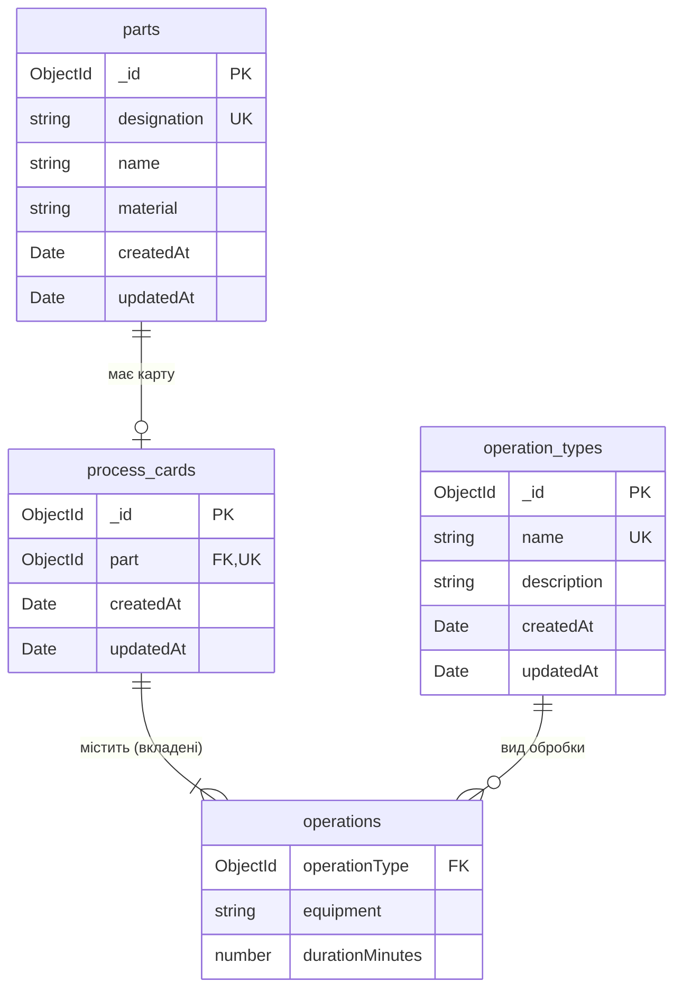

# Схема бази даних

MongoDB 8, база `lab04`.

## ER-діаграма

## Колекції

### `parts` — деталі

| Поле          | Тип            | Обмеження                                                                  |
| ------------- | -------------- | -------------------------------------------------------------------------- |
| `_id`         | ObjectId       | первинний ключ                                                             |
| `designation` | string         | обов'язкове, 3–40 символів (літери, цифри, `.`, `-`, `/`), верхній регістр |
| `name`        | string         | обов'язкове, 2–120 символів                                                |
| `material`    | string \| null | до 80 символів, за замовчуванням `null`                                    |
| `createdAt`   | Date           | ставиться автоматично                                                      |
| `updatedAt`   | Date           | оновлюється автоматично                                                    |

### `operation_types` — види обробки

| Поле          | Тип            | Обмеження                                |
| ------------- | -------------- | ---------------------------------------- |
| `_id`         | ObjectId       | первинний ключ                           |
| `name`        | string         | обов'язкове, 2–60 символів               |
| `description` | string \| null | до 300 символів, за замовчуванням `null` |
| `createdAt`   | Date           | ставиться автоматично                    |
| `updatedAt`   | Date           | оновлюється автоматично                  |

### `process_cards` — технологічні карти

| Поле         | Тип         | Обмеження                                          |
| ------------ | ----------- | -------------------------------------------------- |
| `_id`        | ObjectId    | первинний ключ                                     |
| `part`       | ObjectId    | обов'язкове, посилання на `parts._id`              |
| `operations` | Operation[] | від 1 до 30 вкладених документів, порядок важливий |
| `createdAt`  | Date        | ставиться автоматично                              |
| `updatedAt`  | Date        | оновлюється автоматично                            |

### `operations` — вкладені документи в `process_cards.operations`

| Поле              | Тип            | Обмеження                                       |
| ----------------- | -------------- | ----------------------------------------------- |
| `operationType`   | ObjectId       | обов'язкове, посилання на `operation_types._id` |
| `equipment`       | string \| null | до 120 символів, за замовчуванням `null`        |
| `durationMinutes` | number         | обов'язкове, від 0,1 до 1440 хв з кроком 0,1 хв |

## Індекси

| Колекція          | Ключ                                | Параметри                                             | Призначення                                                |
| ----------------- | ----------------------------------- | ----------------------------------------------------- | ---------------------------------------------------------- |
| `parts`           | `{ _id: 1 }`                        | унікальний                                            | первинний ключ                                             |
| `parts`           | `{ designation: 1 }`                | унікальний                                            | позначення деталі не повторюється                          |
| `operation_types` | `{ _id: 1 }`                        | унікальний                                            | первинний ключ                                             |
| `operation_types` | `{ name: 1 }`                       | унікальний, collation `{ locale: 'uk', strength: 2 }` | назва не повторюється без урахування регістру              |
| `process_cards`   | `{ _id: 1 }`                        | унікальний                                            | первинний ключ                                             |
| `process_cards`   | `{ part: 1 }`                       | унікальний                                            | одна технологічна карта на деталь                          |
| `process_cards`   | `{ 'operations.operationType': 1 }` | multikey                                              | швидка перевірка, чи використовується вид обробки в картах |

## Зв'язки

| Зв'язок                          | Кардинальність | Як зберігається                      | Цілісність                                                      |
| -------------------------------- | -------------- | ------------------------------------ | --------------------------------------------------------------- |
| `parts` → `process_cards`        | 1 : 0..1       | посилання `process_cards.part`       | унікальний індекс; деталь із картою видалити не можна           |
| `process_cards` → `operations`   | 1 : 1..30      | масив вкладених документів у карті   | операції видаляються разом із картою                            |
| `operation_types` → `operations` | 1 : 0..N       | посилання `operations.operationType` | вид обробки, що використовується в операціях, видалити не можна |
